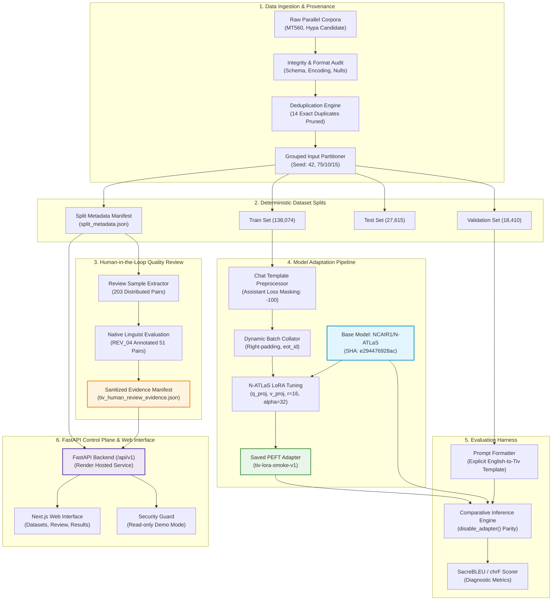

# 02 — System Architecture & Component Design

> **N-ATLaS Language Foundry — Architecture Blueprint**  
> *Author: YiM Consulting Engineering Team*

---

## 1. Architectural Overview

The N-ATLaS Language Foundry is engineered as a decoupled, multi-plane architecture. It cleanly separates the **Data Plane** (ingestion, auditing, splitting), the **Machine Learning Execution Plane** (tokenization, LoRA adaptation, collation, evaluation), the **Control Plane API** (FastAPI service), and the **Presentation Layer** (Next.js web application).



---

## 2. The Architectural Planes

### 2.1 Data Plane & Provenance Management
- **Module:** `foundry.datasets.builder`, `foundry.datasets.split`, `foundry.datasets.record`
- **Purpose:** Transforms uncurated source files into validated, deduplicated, and partition-sealed datasets.
- **Key Invariants Enforced:**
  - Strict Pydantic schema validation for every record: `DatasetRecord(id, input, target, language_code)`.
  - Elimination of exact duplicate input-target pairs.
  - Partitioning via `grouped_by_input` strategy: all occurrences of an English input sentence are deterministically assigned to exactly one split (train, validation, or test) using cryptographic hash buckets.
  - Generates immutable `split_metadata.json` capturing record counts, partition ratios, random seeds, and cryptographic timestamps.

### 2.2 Quality & Human Review Plane
- **Module:** `foundry.review.human_review`, `api.schemas.review_evidence`
- **Purpose:** Bridges automated corpus metrics with qualitative empirical judgments from native speaker linguists.
- **Key Invariants Enforced:**
  - Decoupling of completed offline review pilot data from interactive online review queues.
  - Storage of sanitized, privacy-preserving manifests (`data/manifests/*_human_review_evidence.json`), protecting reviewer identities (`REV_04`) while exposing Likert distributions and qualitative observations.
  - Explicit distinction between reviewer-recorded judgments and automated whole-dataset sign-offs.

### 2.3 ML Adaptation Plane
- **Module:** `foundry.training.preprocessing`, `foundry.training.collator`, `foundry.training.runner`, `foundry.training.model_setup`
- **Purpose:** Executes parameter-efficient Low-Rank Adaptation (LoRA) on `NCAIR1/N-ATLaS`.
- **Key Invariants Enforced:**
  - Tokenization via `apply_chat_template` using the Llama-3-style N-ATLaS tokenizer.
  - **Loss Masking:** Prompt tokens are masked with `IGNORE_INDEX = -100`. Only assistant response tokens and the end-of-turn token (`<|eot_id|>`, ID `128009`) contribute to the loss.
  - **Prefix Verification:** Asserts that tokenized prompt IDs form an exact prefix of the full conversation before computing token offsets.
  - **Dynamic Collation:** Right-padding to the longest sequence in the batch using the native `<|eot_id|>` token, with padded positions assigned attention mask `0` and label `-100`.
  - Target modules: `q_proj` and `v_proj` with rank $r=16$ and scaling $\alpha=32$.

### 2.4 Evaluation Harness
- **Module:** `foundry.evaluation.harness`
- **Purpose:** Provides a standardized, repeatable benchmark comparing the unadapted base model with trained adapters.
- **Key Invariants Enforced:**
  - Explicit task prompt template: `Translate the following English text into Tiv:\n{text}` (`v1-explicit-instruction`).
  - Strict reference target exclusion: reference translations never enter the generation prompt.
  - Inference parity: identical base model weights loaded in 8-bit, with the baseline evaluated via `model.disable_adapter()` under identical greedy decoding settings (`do_sample=False`, `max_new_tokens=128`).
  - Automated scoring via SacreBLEU and chrF.

### 2.5 Control Plane API
- **Module:** `api.main`, `api.schemas`
- **Purpose:** Lightweight FastAPI REST service exposing language registries, dataset metadata, split statistics, review evidence, and experiment records.
- **Key Invariants Enforced:**
  - Decoupled from GPU execution: runs reliably on low-resource container environments (e.g. Render Free Tier).
  - Dynamic discovery of split metadata and review evidence from versioned manifests without needing bulky dataset files.
  - Read-only demonstration mode (`READ_ONLY_MODE=true`) protecting mutating endpoints from unauthenticated writes.
  - Configurable CORS middleware supporting secure frontend communication.

### 2.6 Presentation Layer
- **Module:** `web/app`, `web/components`, `web/lib/api-client.ts`
- **Purpose:** Responsive Next.js 16 web application delivering an intuitive developer portal.
- **Key Invariants Enforced:**
  - `web/lib/api-client.ts` serves as the sole contract boundary.
  - Truthful state rendering: empty registries render clear empty states; unavailable inference renders HTTP 503 retry alerts; missing metadata renders `"Unavailable"` rather than fabricated defaults.

---

## 3. Implementation Status Matrix

To maintain rigorous engineering honesty, the table below clearly delineates operational components from planned targets:

| Component | Status | Implementation Details |
| :--- | :--- | :--- |
| **Language Registry** | **Operational** | Dynamic endpoints `/api/v1/languages` and `/languages/{code}`. |
| **Dataset Ingestion & Splitter** | **Operational** | Deduplication, `grouped_by_input` algorithm, split validation tested. |
| **Split Discovery** | **Operational** | Discovers disk splits and manifest fallbacks (`split_metadata.json`). |
| **Human Review Evidence** | **Operational** | Loaded from sanitized manifests via `/api/v1/datasets/{id}/review-evidence`. |
| **Preprocessing & Loss Masking** | **Operational** | Exact prefix verification, assistant-only supervision (`-100`). |
| **Dynamic Collation** | **Operational** | Right-padding, attention masking, tested with PyTorch tensors. |
| **Evaluation Harness** | **Operational** | Explicit prompt builder, reference exclusion, 7 unit tests passed. |
| **FastAPI Control Plane** | **Operational** | Render containerized deployment, dynamic port, health probes. |
| **Web Portal** | **Operational** | Next.js 16 App Router, contract-backed data flow, zero mock data. |
| **Tiv LoRA Smoke Test** | **Operational** | 4-step optimizer run verifying gradient backpropagation on T4 GPU. |
| *Full Converged Training* | *Planned / Compute-Pending* | Multi-epoch adaptation requires scheduled GPU compute resources. |
| *Live Model Serving* | *Planned / Compute-Pending* | API reports HTTP 503 until dedicated GPU inference worker is deployed. |
| *Durable Review Database* | *Planned* | In-memory store; PostgreSQL persistence planned for post-hackathon. |

---

## 4. Data Flow Walkthrough

```
1. Developer registers raw dataset ──► Ingestion audit verifies UTF-8 & required columns
2. Deduplication engine runs ──► Prunes identical sentence pairs (14 pruned for Tiv)
3. Grouped partitioner executes ──► Deterministic 75/10/15 split sealed into split_metadata.json
4. Preprocessor prepares training ──► Chat template tokenization with assistant loss masking (-100)
5. LoRA runner trains adapter ──► Saves adapter_model.safetensors (<30 MB)
6. Evaluation harness benchmarks ──► Standard prompt sent to base (disable_adapter) vs adapted model
7. Metadata manifest published ──► FastAPI loads metadata & serves to Next.js frontend
```

---
*Next: Examine the detailed codebase implementation in [03-technical-implementation.md](./03-technical-implementation.md).*
