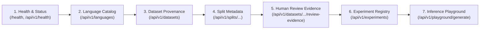

# Beta Testing Guide

Welcome to the N-ATLaS Language Foundry Beta Testing Program. This guide provides step-by-step instructions for testing the hosted deployment, exercising the API and web interfaces, evaluating data integrity features, and submitting actionable feedback.

---

## 1. Overview & Public Endpoints

The N-ATLaS Language Foundry control plane is publicly deployed on Render and also runs locally via Docker:

* **Production Deployed URL**: [https://yim-n-atlas-language-foundry.onrender.com](https://yim-n-atlas-language-foundry.onrender.com)
* **Local Development Base URL**: `http://localhost:8000`
* **Interactive OpenAPI Swagger Docs**: [https://yim-n-atlas-language-foundry.onrender.com/docs](https://yim-n-atlas-language-foundry.onrender.com/docs)
* **Interactive ReDoc Specification**: [https://yim-n-atlas-language-foundry.onrender.com/redoc](https://yim-n-atlas-language-foundry.onrender.com/redoc)
* **Raw OpenAPI Specification (JSON)**: [https://yim-n-atlas-language-foundry.onrender.com/openapi.json](https://yim-n-atlas-language-foundry.onrender.com/openapi.json)
* **Target Audience**: Hackathon reviewers, external testers, linguists, and backend engineers.

> [!NOTE]
> The hosted deployment runs on a lightweight, cost-effective container tier designed as a metadata, dataset governance, review evidence, and experimentation control plane. It does **not** mount a multi-gigabyte GPU or run live 8-billion-parameter LLM weights in production memory.

---

## 2. Platform Architecture & Feature Tour

When testing the platform, explore features in the recommended workflow sequence:



### Feature Exploration Order

| Step | Component | Endpoint / View | What to Validate |
| :--- | :--- | :--- | :--- |
| **1** | **System Health & Info** | `GET /` & `GET /health` (`/api/v1/health`, `/healthz`) | Confirms container liveness, application uptime, service version (`0.1.0`), and read-only mode status. |
| **2** | **Language Registry** | `GET /api/v1/languages` & `GET /api/v1/languages/tiv` | Verifies language registry metadata, specifically the pilot language **Tiv** (`tiv`, status `data_available`). |
| **3** | **Dataset Provenance** | `GET /api/v1/datasets` & `GET /api/v1/datasets/tiv-mt560-v1` | Audits the canonical dataset `tiv-mt560-v1` metadata, version git commit, and clean 184,099 record count. |
| **4** | **Split Verification** | `GET /api/v1/splits/tiv-mt560-v1-split-42` | Verifies deterministic partitioning (138,074 train, 18,410 val, 27,615 test) and leakage-free grouped split strategy. |
| **5** | **Review Evidence** | `GET /api/v1/datasets/tiv-mt560-v1/review-evidence` | Inspects sanitized, empirical human evaluation metrics from native speaker reviewer `REV_04` (51 records, 4.76/5 accuracy). |
| **6** | **Experiments** | `GET /api/v1/experiments` | Audits experiment registry behavior. Confirms clean, empty production registry with zero fabricated mock runs. |
| **7** | **Inference Playground** | `POST /api/v1/playground/generate` | Confirms system truthfulness: returns `503 Service Unavailable` with descriptive message when GPU inference worker is offline. |

---

## 3. Safe API Verification Tasks

You can execute these safe, non-destructive checks using `curl`, Postman, or the browser against either the hosted Render endpoint or your local instance (`http://localhost:8000`).

### Task 1: Check System Liveness and Root Service Information
Test the root endpoint and health check probe:
```bash
# 1. Health check probe
curl -s -X GET "https://yim-n-atlas-language-foundry.onrender.com/health" | jq .

# 2. Root service info and route index
curl -s -X GET "https://yim-n-atlas-language-foundry.onrender.com/" | jq .
```

**Expected Health Output (`GET /health`, `/api/v1/health`, or `/healthz`)**:
```json
{
  "status": "ok",
  "service": "natlas-foundry-api",
  "version": "0.1.0",
  "timestamp": "2026-10-12T18:04:34.007971+00:00"
}
```

**Expected Root Output (`GET /`)**:
```json
{
  "service": "N-ATLAS Language Foundry Control Plane",
  "status": "healthy",
  "version": "0.1.0",
  "read_only_mode": false,
  "docs_url": "/docs",
  "health_url": "/health",
  "review_requests_url": "/api/v1/review/requests",
  "review_evidence_url": "/api/v1/datasets/{dataset_id}/review-evidence"
}
```

---

### Task 2: Retrieve Languages Catalog & Tiv Language Profile
Retrieve the catalog of tracked Nigerian languages, then query the pilot profile for Tiv:
```bash
# List all registered languages
curl -s -X GET "https://yim-n-atlas-language-foundry.onrender.com/api/v1/languages" | jq .

# Query Tiv language profile specifically
curl -s -X GET "https://yim-n-atlas-language-foundry.onrender.com/api/v1/languages/tiv" | jq .
```

**Expected Catalog Output (`GET /api/v1/languages`)**:
```json
{
  "items": [
    {
      "id": "lang-tiv-001",
      "code": "tiv",
      "name": "Tiv",
      "status": "data_available",
      "description": "Primary pilot language with verified English-Tiv parallel corpus and splits.",
      "created_at": "2026-10-12T17:25:00.497063+00:00",
      "updated_at": "2026-10-12T17:25:00.497063+00:00"
    },
    {
      "id": "lang-igl-002",
      "code": "igl",
      "name": "Igala",
      "status": "discovered",
      "description": "Exploratory Nigerian language under provenance and corpus investigation.",
      "created_at": "2026-10-12T17:25:00.497063+00:00",
      "updated_at": "2026-10-12T17:25:00.497063+00:00"
    },
    {
      "id": "lang-yor-003",
      "code": "yor",
      "name": "Yoruba",
      "status": "discovered",
      "description": "Benchmark Nigerian language supported in base N-ATLaS model.",
      "created_at": "2026-10-12T17:25:00.497063+00:00",
      "updated_at": "2026-10-12T17:25:00.497063+00:00"
    },
    {
      "id": "lang-ha-004",
      "code": "ha",
      "name": "Hausa",
      "status": "discovered",
      "description": "Benchmark Nigerian language supported in base N-ATLaS model.",
      "created_at": "2026-10-12T17:25:00.497063+00:00",
      "updated_at": "2026-10-12T17:25:00.497063+00:00"
    },
    {
      "id": "lang-ibo-005",
      "code": "ibo",
      "name": "Igbo",
      "status": "discovered",
      "description": "Benchmark Nigerian language supported in base N-ATLaS model.",
      "created_at": "2026-10-12T17:25:00.497063+00:00",
      "updated_at": "2026-10-12T17:25:00.497063+00:00"
    }
  ],
  "total": 5
}
```

---

### Task 3: Inspect Dataset Provenance and Verified Split Integrity
Inspect the canonical dataset registration for `tiv-mt560-v1` and verify the exact deterministic split:
```bash
# Query the canonical dataset metadata
curl -s -X GET "https://yim-n-atlas-language-foundry.onrender.com/api/v1/datasets/tiv-mt560-v1" | jq .

# Query the deterministic split partition
curl -s -X GET "https://yim-n-atlas-language-foundry.onrender.com/api/v1/splits/tiv-mt560-v1-split-42" | jq .
```

**Expected Dataset Output (`GET /api/v1/datasets/tiv-mt560-v1`)**:
```json
{
  "id": "tiv-mt560-v1",
  "language_code": "tiv",
  "name": "Tiv MT560 Parallel Corpus V1",
  "description": "English-Tiv sentence pairs from MT560 with deterministic grouped splitting.",
  "format": "jsonl",
  "source_type": "research",
  "record_count": 184099,
  "train_records": 138074,
  "validation_records": 18410,
  "test_records": 27615,
  "split_id": "tiv-mt560-v1-split-42",
  "provenance_id": "prov-tiv-mt560",
  "version": "252074f0d4c82c0005099b5eb4043fddc43026f1",
  "status": "registered",
  "local_path": "data/processed/tiv-mt560-v1",
  "created_at": "2026-10-12T17:25:00.497063+00:00",
  "updated_at": "2026-10-12T17:25:00.497063+00:00"
}
```

**Expected Split Output (`GET /api/v1/splits/tiv-mt560-v1-split-42`)**:
```json
{
  "id": "tiv-mt560-v1-split-42",
  "dataset_id": "tiv-mt560-v1",
  "strategy": "grouped_by_input",
  "seed": 42,
  "train_ratio": 0.75,
  "validation_ratio": 0.1,
  "test_ratio": 0.15,
  "total_records": 184099,
  "train_records": 138074,
  "validation_records": 18410,
  "test_records": 27615,
  "created_at": "2026-10-11T02:21:58.238666Z"
}
```

---

### Task 4: Inspect Sanitized Human Review Metrics
Inspect the verified empirical human evaluation metrics extracted from native speaker reviewer `REV_04`:
```bash
curl -s -X GET "https://yim-n-atlas-language-foundry.onrender.com/api/v1/datasets/tiv-mt560-v1/review-evidence" | jq .
```

**Expected Output (`GET /api/v1/datasets/tiv-mt560-v1/review-evidence`)**:
```json
{
  "dataset_id": "tiv-mt560-v1",
  "language_code": "tiv",
  "review_type": "offline_manual_pilot",
  "artifact_name": "Tiv Translation Pilot - Manual Review Distribution_2.xlsx",
  "sheet_name": "Receiver 4",
  "status": "in_progress",
  "total_sampled_records": 203,
  "reviewed_records": 51,
  "pending_records": 152,
  "coverage_ratio": 0.2512,
  "sources_breakdown": {
    "mt560": 50,
    "hypa": 1
  },
  "reviewer_scope": {
    "assigned_reviewers": [
      "REV_01",
      "REV_02",
      "REV_03",
      "REV_04"
    ],
    "completed_reviewers": [
      "REV_04"
    ],
    "pending_reviewers": [
      "REV_01",
      "REV_02",
      "REV_03"
    ]
  },
  "metrics": {
    "translation_accurate": {
      "metric_name": "Translation Accuracy",
      "scale": "1-5",
      "description": "Fidelity of translated meaning compared to source English sentence (5 = Perfectly accurate, 4 = Accurate with minor nuance differences).",
      "mean_score": 4.7647,
      "pass_count": 51,
      "total_count": 51,
      "score_distribution": {
        "4": 12,
        "5": 39
      }
    },
    "meaning_complete": {
      "metric_name": "Meaning Completeness",
      "scale": "yes/no",
      "description": "Preservation of full meaning without omissions or hallucinations.",
      "mean_score": null,
      "pass_count": 51,
      "total_count": 51,
      "score_distribution": {
        "Yes": 51
      }
    },
    "tiv_naturalness": {
      "metric_name": "Tiv Naturalness",
      "scale": "1-5",
      "description": "Fluency and idiomatic phrasing in native Tiv (5 = Highly fluent native Tiv phrasing).",
      "mean_score": 5.0,
      "pass_count": 51,
      "total_count": 51,
      "score_distribution": {
        "5": 51
      }
    },
    "format_acceptable": {
      "metric_name": "Formatting Acceptability",
      "scale": "yes/no",
      "description": "Correct preservation of punctuation, casing, quotes, brackets, and alphanumeric tokens.",
      "mean_score": null,
      "pass_count": 51,
      "total_count": 51,
      "score_distribution": {
        "Yes": 51
      }
    }
  },
  "qualitative_findings": [
    "Native idiomatic phrasing consistently validated (e.g. 'zwa Buter' for English language).",
    "Score 4 annotations occurred primarily on external page-number shifts (e.g., page 29 in source English referenced as page 11 in target Tiv publication edition).",
    "Alphanumeric structured reference tokens (e.g., 'A - D ) .') and standard biblical orthography ('Ekesodu') correctly maintained across parallel segments.",
    "Lexical repetition in historic slogans ('yôô nen , yôô nen') verified as grammatically appropriate imperative emphasis in natural Tiv."
  ],
  "qualification": "Reviewer-reported and reviewer-recorded judgments from evaluator REV_04 during the manual pilot. These figures represent sample observations (51/203 pairs) and do not constitute independent automated quality verification or complete dataset sign-off.",
  "evaluated_at": "2026-10-12T10:00:00Z"
}
```

---

### Task 5: Verify Playground Inference Truthfulness
Submit an inference request conforming to the `PlaygroundRequest` OpenAPI schema to test the backend response:
```bash
curl -i -s -X POST "https://yim-n-atlas-language-foundry.onrender.com/api/v1/playground/generate" \
  -H "Content-Type: application/json" \
  -d '{
    "prompt": "Translate the following English text into Tiv:\nGood morning.",
    "language_code": "tiv",
    "max_new_tokens": 128,
    "do_sample": false
  }'
```

**Expected Output**:
* HTTP Status: `503 Service Unavailable`
* Response Header: `content-type: application/json`
* JSON payload:
```json
{
  "detail": "Model inference is currently unavailable. Real inference endpoints are pending model hosting and adapter deployment."
}
```

> [!IMPORTANT]
> **Understanding HTTP 503 in the Playground**: Receiving an HTTP 503 is **expected and correct** behavior on the hosted instance. Do **not** log an HTTP 503 in the playground as a bug or broken endpoint. It represents strict system truthfulness: the platform refuses to return hallucinated or fake translations when real GPU inference is unavailable.

---

### Task 6: Audit Experiment Registry Behavior
Verify that the production experiment registry is clean and truthful, reporting only real registered experiments without fabricated benchmark runs:
```bash
curl -s -X GET "https://yim-n-atlas-language-foundry.onrender.com/api/v1/experiments" | jq .
```

**Expected Output**:
```json
{
  "items": [],
  "total": 0
}
```

---

### Task 7: Verify Safe Write-Protection Guard
Test a batch review submission against `POST /api/v1/review/submit` using the `BatchSubmitRequest` schema:
```bash
curl -i -s -X POST "https://yim-n-atlas-language-foundry.onrender.com/api/v1/review/submit" \
  -H "Content-Type: application/json" \
  -d '{
    "dataset_id": "tiv-mt560-v1",
    "reviewer_id": "REV_04",
    "decisions": []
  }'
```

**Expected Output**:
* In normal mode (`READ_ONLY_MODE=false`), returns HTTP `201 Created`:
  ```json
  {
    "status": "success",
    "dataset_id": "tiv-mt560-v1",
    "reviewer_id": "REV_04",
    "processed_decisions": 0,
    "message": "Successfully recorded 0 audit decisions.",
    "timestamp": "2026-10-12T18:00:57.879142+00:00"
  }
  ```
* In protected demonstration mode (`READ_ONLY_MODE=true` without `ADMIN_API_KEY`), returns HTTP `403 Forbidden`:
  ```json
  {
    "detail": "Public review submission is disabled in demonstration mode. The API is currently configured for read-only demonstration."
  }
  ```

---

## 4. What Beta Testers Should Focus On

We are requesting feedback in four core dimensions:

1. **Information Architecture & Usability**:
   * Are dataset provenance, split criteria, and human-review evidence easy to discover and understand?
   * Does the interactive OpenAPI documentation clearly describe parameter constraints and return types?
2. **Data Integrity & Traceability**:
   * Does the split metadata provide sufficient confidence that training and test data do not leak?
   * Are the human-review metrics presented with appropriate statistical context (partial sample of 51 out of 203 records)?
3. **Platform Transparency**:
   * Is the separation between the deployed control plane and the external GPU training environment clear?
   * Does the frontend clearly communicate when an experiment or inference service is offline without crashing?
4. **Developer Experience**:
   * Are error messages helpful and actionable?
   * Is the API contract intuitive for building downstream integrations?

---

## 5. Security & Data Governance Guidelines

To protect intellectual property, privacy, and system security during the testing period:

* **DO NOT** submit sensitive personal data, proprietary text, or passwords into any form or endpoint.
* **DO NOT** attempt to paste raw review workbooks, reviewer personal identifying information (PII), or contact details.
* **DO NOT** attempt denial-of-service, automated credential fuzzing, or load testing against the public Render endpoint.
* Note that write endpoints (`POST /api/v1/review/submit` and `POST /api/v1/review/decisions`) are guarded by `READ_ONLY_MODE=true` when configured for protected public demonstrations and will return `403 Forbidden` unless authorized.

---

## 6. Feedback & Bug Reporting Template

If you encounter an unexpected error, confusing interface behavior, or discrepancy, please copy the template below and submit your report to the team:

```markdown
### N-ATLaS Foundry Beta Feedback Report

**Date & Time (UTC)**: YYYY-MM-DD HH:MM
**Tester Role / Background**: [e.g., Software Engineer / Linguist / Reviewer]
**Environment**: [e.g., Hosted Render / Local Docker / Chrome 124 / macOS]

#### 1. Area Tested
- [ ] System Health & Info
- [ ] Language Registry
- [ ] Dataset Provenance & Splits
- [ ] Human Review Evidence
- [ ] Experiments Registry
- [ ] Playground & Inference
- [ ] API Contract & Documentation

#### 2. Endpoint or Web Page
`GET /api/v1/...` or `https://yim-n-atlas-language-foundry.onrender.com/...`

#### 3. Steps to Reproduce
1. Navigate to ...
2. Send request with payload ...
3. Observe response ...

#### 4. Expected Behavior
[What you expected to happen based on documentation]

#### 5. Actual Behavior
[What actually occurred, including HTTP status code and response body]

#### 6. Usability or Clarity Feedback
[Any suggestions for clearer labeling, improved formatting, or missing metadata]
```

Thank you for contributing to the testing and refinement of the N-ATLaS Language Foundry!
