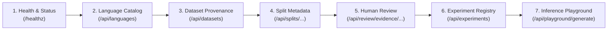

# Beta Testing Guide

Welcome to the N-ATLaS Language Foundry Beta Testing Program. This guide provides step-by-step instructions for testing the hosted deployment, exercising the API and web interfaces, evaluating data integrity features, and submitting actionable feedback.

---

## 1. Overview & Public Endpoint

The N-ATLaS Language Foundry control plane is publicly deployed on Render:

* **Deployment URL**: [https://yim-n-atlas-language-foundry.onrender.com](https://yim-n-atlas-language-foundry.onrender.com)
* **Interactive OpenAPI Docs**: [https://yim-n-atlas-language-foundry.onrender.com/docs](https://yim-n-atlas-language-foundry.onrender.com/docs)
* **Raw OpenAPI Specification**: [https://yim-n-atlas-language-foundry.onrender.com/openapi.json](https://yim-n-atlas-language-foundry.onrender.com/openapi.json)
* **Target Audience**: Hackathon reviewers, external testers, linguists, and backend engineers.

> [!NOTE]
> The hosted deployment runs on a lightweight, cost-effective container tier designed as a metadata, dataset governance, review evidence, and experimentation control plane. It does **not** mount a multi-gigabyte GPU or run live 8-billion-parameter LLM weights in production memory.

---

## 2. Platform Architecture & Feature Tour

When testing the platform, explore features in the recommended workflow sequence:



### Feature Exploration Order

| Step | Component | Endpoint / View | What to Validate |
| :--- | :--- | :--- | :--- |
| **1** | **System Health** | `GET /healthz` | Confirms container liveness, application uptime, and read-only demo mode status (`read_only_demo: true`). |
| **2** | **Language Registry** | `GET /api/languages` | Verifies language registry metadata, specifically the pilot language **Tiv** (`tiv`, Niger-Congo, Benue-Congo, Tivoid). |
| **3** | **Dataset Provenance** | `GET /api/datasets` | Audits the canonical dataset `tiv-mt560-v1` metadata, source URI, license (`CC BY 4.0`), and record statistics. |
| **4** | **Split Verification** | `GET /api/splits/tiv-mt560-v1-split-42` | Verifies deterministic partitioning (138,074 train, 18,410 val, 27,615 test) and leakage-free grouped split strategy. |
| **5** | **Review Evidence** | `GET /api/review/evidence/tiv-mt560-v1` | Inspects sanitized, empirical human evaluation metrics from native speaker reviewer `REV_04` (51 records, 4.76/5 accuracy). |
| **6** | **Experiments** | `GET /api/experiments` | Audits experiment registry behavior. Confirms clean, empty production registry with zero fabricated mock runs. |
| **7** | **Inference Playground** | `POST /api/playground/generate` | Confirms system truthfulness: returns `503 Service Unavailable` with descriptive message when GPU inference worker is offline. |

---

## 3. Safe API Verification Tasks

You can execute these safe, non-destructive checks using `curl`, Postman, or the browser.

### Task 1: Check System Liveness
```bash
curl -s -X GET "https://yim-n-atlas-language-foundry.onrender.com/healthz" | jq .
```
**Expected Output**:
```json
{
  "status": "healthy",
  "version": "0.1.0",
  "read_only_demo": true,
  "loaded_splits": 1,
  "loaded_review_evidence": 1
}
```

### Task 2: Retrieve Tiv Language Profile
```bash
curl -s -X GET "https://yim-n-atlas-language-foundry.onrender.com/api/languages" | jq '.languages[] | select(.code == "tiv")'
```
**Expected Output**:
```json
{
  "code": "tiv",
  "name": "Tiv",
  "family": "Niger-Congo",
  "subfamily": "Benue-Congo (Tivoid)",
  "speakers_estimate": "5,000,000+",
  "region": "Benue State, Taraba, Nasarawa, Cross River (Nigeria)",
  "status": "Pilot",
  "description": "Primary pilot language for N-ATLaS low-resource LoRA adaptation."
}
```

### Task 3: Inspect Verified Split Integrity
```bash
curl -s -X GET "https://yim-n-atlas-language-foundry.onrender.com/api/splits/tiv-mt560-v1-split-42" | jq .
```
**Expected Output**:
```json
{
  "split_id": "tiv-mt560-v1-split-42",
  "dataset_id": "tiv-mt560-v1",
  "strategy": "grouped_by_input",
  "seed": 42,
  "train_count": 138074,
  "validation_count": 18410,
  "test_count": 27615,
  "total_count": 184099,
  "created_at": "2026-04-06T15:00:00Z"
}
```

### Task 4: Inspect Sanitized Human Review Metrics
```bash
curl -s -X GET "https://yim-n-atlas-language-foundry.onrender.com/api/review/evidence/tiv-mt560-v1" | jq .
```
**Expected Output**:
* Shows 51 total reviewed records.
* Mean translation accuracy score of `4.7647 / 5`.
* 100% meaning completeness, 5.0 naturalness, and 100% format acceptability.
* Identifies qualitative flags (e.g., loanword usage, word order, citation shifts).

### Task 5: Verify Playground Inference Truthfulness
Submit an inference request to test the backend response:
```bash
curl -s -X POST "https://yim-n-atlas-language-foundry.onrender.com/api/playground/generate" \
  -H "Content-Type: application/json" \
  -d '{
    "model_id": "NCAIR1/N-ATLaS",
    "prompt": "Translate the following English text into Tiv:\nGood morning.",
    "temperature": 0.7,
    "max_new_tokens": 64
  }' | jq .
```
**Expected Output**:
* HTTP Status: `503 Service Unavailable`
* JSON payload:
```json
{
  "detail": "Inference backend is currently offline. Model weights (8B parameters) require dedicated GPU compute and are not hosted on this demo instance."
}
```

> [!IMPORTANT]
> **Understanding HTTP 503 in the Playground**: Receiving an HTTP 503 is **expected and correct** behavior on the hosted instance. Do **not** log an HTTP 503 in the playground as a bug or broken endpoint. It represents strict system truthfulness: the platform refuses to return hallucinated or fake translations when real GPU inference is unavailable.

---

## 4. What Beta Testers Should Focus On

We are requesting feedback in four core dimensions:

1. **Information Architecture & Usability**:
   * Are dataset provenance, split criteria, and human-review evidence easy to discover and understand?
   * Does the interactive OpenAPI documentation clearly describe parameter constraints and return types?
2. **Data Integrity & Traceability**:
   * Does the split metadata provide sufficient confidence that training and test data do not leak?
   * Are the human-review metrics presented with appropriate statistical context (partial sample of 51 out of 203 records)?
3. **Platform Transparency**:
   * Is the separation between the deployed control plane and the external GPU training environment clear?
   * Does the frontend clearly communicate when an experiment or inference service is offline without crashing?
4. **Developer Experience**:
   * Are error messages helpful and actionable?
   * Is the API contract intuitive for building downstream integrations?

---

## 5. Security & Data Governance Guidelines

To protect intellectual property, privacy, and system security during the testing period:

* **DO NOT** submit sensitive personal data, proprietary text, or passwords into any form or endpoint.
* **DO NOT** attempt to paste raw review workbooks, reviewer personal identifying information (PII), or contact details.
* **DO NOT** attempt denial-of-service, automated credential fuzzing, or load testing against the public Render endpoint.
* Note that write endpoints (such as `POST /api/review/decision`) are protected in the public instance by a read-only demo guard (`FOUNDRY_READ_ONLY_DEMO=true`) and will return `403 Forbidden`.

---

## 6. Feedback & Bug Reporting Template

If you encounter an unexpected error, confusing interface behavior, or discrepancy, please copy the template below and submit your report to the team:

```markdown
### N-ATLaS Foundry Beta Feedback Report

**Date & Time (UTC)**: YYYY-MM-DD HH:MM
**Tester Role / Background**: [e.g., Software Engineer / Linguist / Reviewer]
**Environment**: [e.g., Hosted Render / Local Docker / Chrome 124 / macOS]

#### 1. Area Tested
- [ ] System Health & Info
- [ ] Language Registry
- [ ] Dataset Provenance & Splits
- [ ] Human Review Evidence
- [ ] Experiments Registry
- [ ] Playground & Inference
- [ ] API Contract & Documentation

#### 2. Endpoint or Web Page
`GET /api/...` or `https://yim-n-atlas-language-foundry.onrender.com/...`

#### 3. Steps to Reproduce
1. Navigate to ...
2. Send request with payload ...
3. Observe response ...

#### 4. Expected Behavior
[What you expected to happen based on documentation]

#### 5. Actual Behavior
[What actually occurred, including HTTP status code and response body]

#### 6. Usability or Clarity Feedback
[Any suggestions for clearer labeling, improved formatting, or missing metadata]
```

Thank you for contributing to the testing and refinement of the N-ATLaS Language Foundry!
