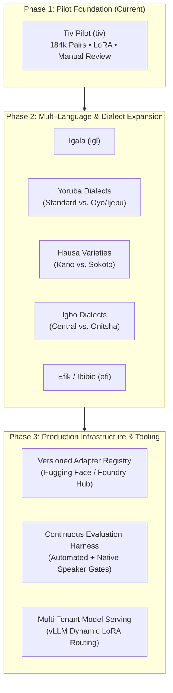

# Roadmap & Resource Requirements

This document outlines the strategic progression of the N-ATLaS Language Foundry from its initial Tiv pilot into a comprehensive, multi-language adaptation platform for Nigerian languages and dialects. It provides a detailed infrastructure breakdown of computational and hardware resources required across development phases.

---

## 1. Vision: A Scalable Nigerian Language Adaptation Ecosystem

Nigeria is home to over 500 distinct languages and numerous regional dialects. Standard general-purpose Large Language Models fail to represent the vast majority of these languages due to severe training data imbalances and tokenization inefficiencies.

The long-term objective of the N-ATLaS Language Foundry is to serve as **reusable developer infrastructure** that democratizes the creation, verification, and distribution of low-resource African language models.

### Language vs. Dialect Adaptation Strategy
A central architectural principle of the Foundry is discerning when a distinct model adapter is justified:
* **Distinct Languages**: Languages with distinct grammatical structures, phonologies, and lexicons (e.g., Tiv, Igala, Yoruba, Kanuri) require dedicated adapters trained on language-specific corpora.
* **Dialects and Regional Varieties**: Varieties of a single language (e.g., standard Yoruba vs. Ijebu, or Kano Hausa vs. Sokoto Hausa) often share foundational grammar but diverge significantly in lexical choices, idioms, and orthographic conventions.
* **Evidence-Based Partitioning**: The Foundry does not assume every dialect requires a distinct adapter. Instead, dialect-specific adapters are only trained when empirical error analysis or human review demonstrates that a unified base adapter fails to achieve acceptable naturalness in that regional variety.

---

## 2. Platform Roadmap

### Phase 1: Pilot Validation & Foundation (Current)
* [x] Standardize canonical dataset schema (`id`, `input`, `target`, `language_code`).
* [x] Build deterministic, input-grouped splitting pipeline with zero train/test leakage.
* [x] Ingest and sanitize empirical human review evidence for Tiv (`REV_04`).
* [x] Implement memory-efficient LoRA training pipeline on 8B base model.
* [x] Build standardized evaluation harness with explicit prompt templates.
* [x] Deploy public FastAPI metadata and governance control plane on Render.

### Phase 2: Multi-Language Expansion & Persistent Governance (Next 3–6 Months)
* [ ] **Persistent Relational Database**: Migrate review submissions and experiment tracking from in-memory structures to PostgreSQL with SQLAlchemy/Alembic.
* [ ] **Ingest Additional Languages**: Expand beyond Tiv to include Igala (`igl`), Berom (`bom`), and Idoma (`idu`).
* [ ] **Multi-Reviewer Annotation Queue**: Implement full 203-record review distribution across reviewers `REV_01` through `REV_04` with inter-annotator agreement scoring (Cohen's Kappa).
* [ ] **Automated License & Provenance Verification**: Programmatic integration with Hugging Face Hub metadata to automatically flag unverified or non-commercial licenses.

### Phase 3: Automated Adapter Hub & Serving Infrastructure (6–12 Months)
* [ ] **Foundry Adapter Hub**: Versioned public registry where community developers can publish, download, and cite validated LoRA weights with complete dataset lineage.
* [ ] **Dynamic LoRA Serving**: Deploy a high-throughput vLLM cluster capable of loading the base N-ATLaS 8B model once and dynamically swapping language LoRA adapters per request based on target language header.
* [ ] **Community Evaluation Benchmarks**: Public leaderboard for Nigerian language translation, summarization, and question answering with human-in-the-loop scoring.

---

## 3. Computational Resource Requirements

Adapting, evaluating, and serving 8-billion-parameter foundation models requires distinct computational tiers. The table below details resource allocations across environments:

| Tier | Function | Compute Target | Memory (RAM / VRAM) | Storage | Feasibility in Current Setup |
| :--- | :--- | :--- | :--- | :--- | :--- |
| **Tier 1: Web & Control Plane** | FastAPI backend, Next.js UI, metadata registry, dataset verification, unit testing. | 1–2 vCPUs | 1 GB – 2 GB RAM (No GPU) | 1 GB SSD | **Fully operational** on current Render deployment and local development machines. |
| **Tier 2: Pipeline Validation & Smoke Runs** | Pipeline verification, tensor shape validation, gradient backward smoke tests. | 1x NVIDIA T4 (Google Colab / AWS g4dn) | 16 GB System RAM, 16 GB VRAM | 30 GB SSD (model caching) | **Demonstrated** via Colab T4 smoke test (`tiv-lora-smoke-v1`). |
| **Tier 3: Rigorous Benchmark Evaluation** | Generating outputs for 1,000+ test samples across base and adapted models; calculating BLEU/chrF. | 1x NVIDIA T4 or A10G | 16 GB System RAM, 16–24 GB VRAM | 50 GB SSD | **Ready to execute**; requires 2–4 hours of continuous cloud GPU execution time. |
| **Tier 4: Full Multi-Epoch Adapter Training** | Full training on 138,074 records (batch size 1, grad accum 8–16, 1–3 epochs). | 1x NVIDIA A100 (40GB/80GB) or 2x A10G | 32 GB System RAM, 24–40 GB VRAM | 100 GB NVMe | **Requires dedicated cloud GPU budget**; estimated 12–24 hours on A100. |
| **Tier 5: Multi-Tenant Production Inference** | High-throughput serving with dynamic adapter switching (vLLM / Triton). | 1x–2x NVIDIA A10G / L4 | 32 GB RAM, 24 GB VRAM per worker | 150 GB NVMe | **Production scaling target**; requires dedicated enterprise hosting. |

---

## 4. Hardware Constraints & Considerations (Tesla T4 Environment)

The Tesla T4 (16GB VRAM) represents the most accessible cloud accelerator (available in free/starter Colab tiers and budget cloud providers). Operating an 8B parameter model like N-ATLaS on a T4 introduces critical engineering constraints:

1. **Parameter Quantization / Precision**:
   * Storing 8 billion parameters in 16-bit half-precision (`float16` or `bfloat16`) consumes approximately **16 GB of VRAM** for weights alone, leaving zero headroom for activations or optimizer states.
   * Fine-tuning on a single T4 requires **4-bit NormalFloat (NF4) quantization** via bitsandbytes (QLoRA) or offloading, reducing base model memory to ~5.5 GB VRAM and leaving ~10 GB for LoRA adapter gradients and activation tensors.
2. **Batch Size and Sequence Length Limits**:
   * On a 16GB T4, training per-device batch size must be restricted to `1` with gradient accumulation steps (`8` to `16`) to emulate larger effective batch sizes without triggering Out-Of-Memory (OOM) errors.
   * Maximum sequence length must be clamped to `256` or `512` tokens. Longer sequences increase attention memory quadratically unless FlashAttention-2 or xFormers are enabled.
3. **Training Time vs. Dataset Size**:
   * With 138,074 training records in `tiv-mt560-v1`, an effective batch size of 8 or 16 requires ~8,600 to ~17,200 optimizer steps per epoch.
   * On a T4, processing 1 step (16 forward/backward passes) takes approximately 1.2–2.0 seconds. A full epoch on a T4 would require **18–28 hours** of continuous compute, making an A100 or multi-GPU setup significantly more practical for full training runs.

---

## 5. Compute Acquisition Strategy

To execute the roadmap objectives without unnecessary overhead, the team adopts a tiered compute acquisition strategy:

1. **Short-Term (Hackathon Evaluation)**:
   * Utilize ephemeral Google Colab Pro or AWS EC2 `g4dn.xlarge` / `g5.xlarge` instances to execute the standardized evaluation harness on the test split.
   * Estimated compute needed: 10–15 GPU hours.
2. **Medium-Term (Multi-Language Training Runs)**:
   * Leverage academic/research compute grants or cloud credits (e.g., Google Cloud Research Credits, AWS Open Source Grants) on A100 instances for full 138k-pair training runs across Tiv, Igala, and Yoruba.
   * Estimated compute needed: 100–200 GPU hours.
3. **Long-Term (Community Model Hub & Serving)**:
   * Partner with African AI infrastructure providers (such as NCAIR, Data Science Nigeria, or Lelapa AI) to host shared adapter repository mirrors and low-latency API inference endpoints for Nigerian developers.
