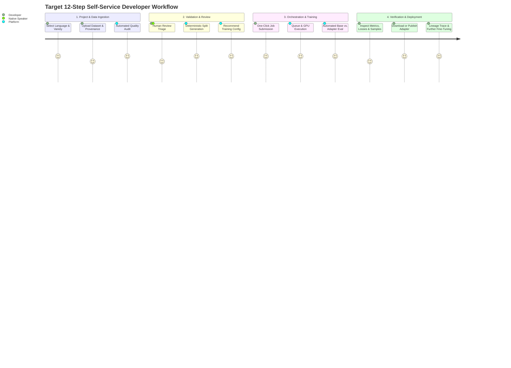
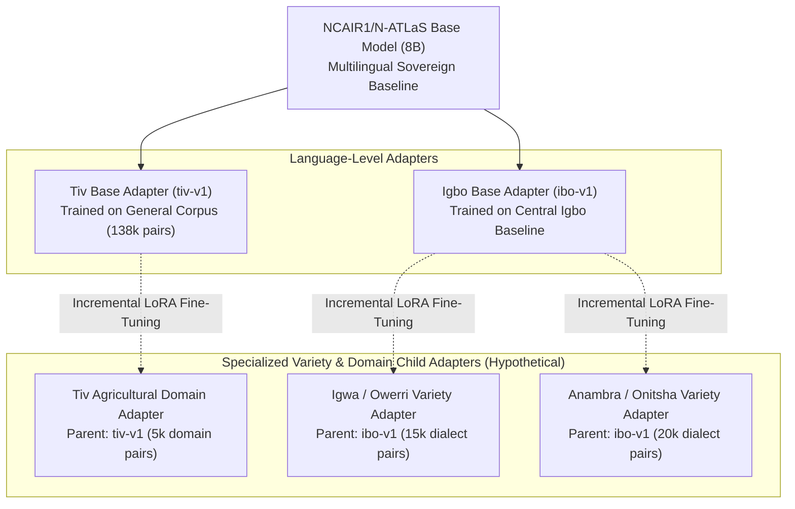
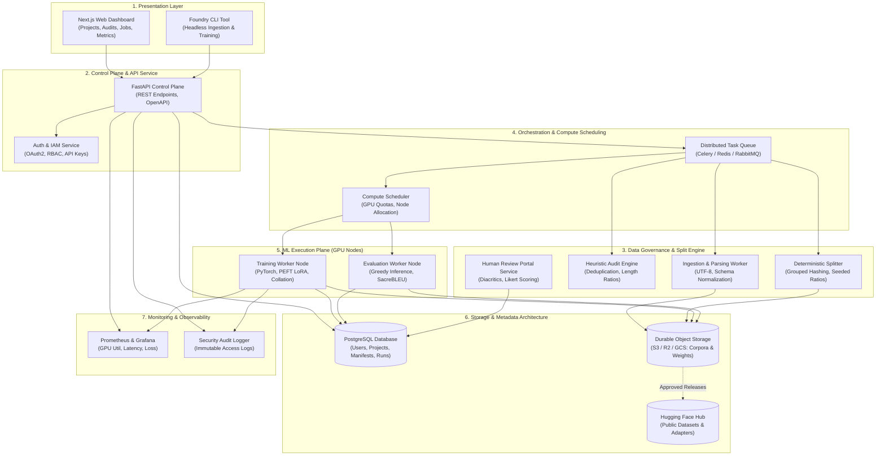
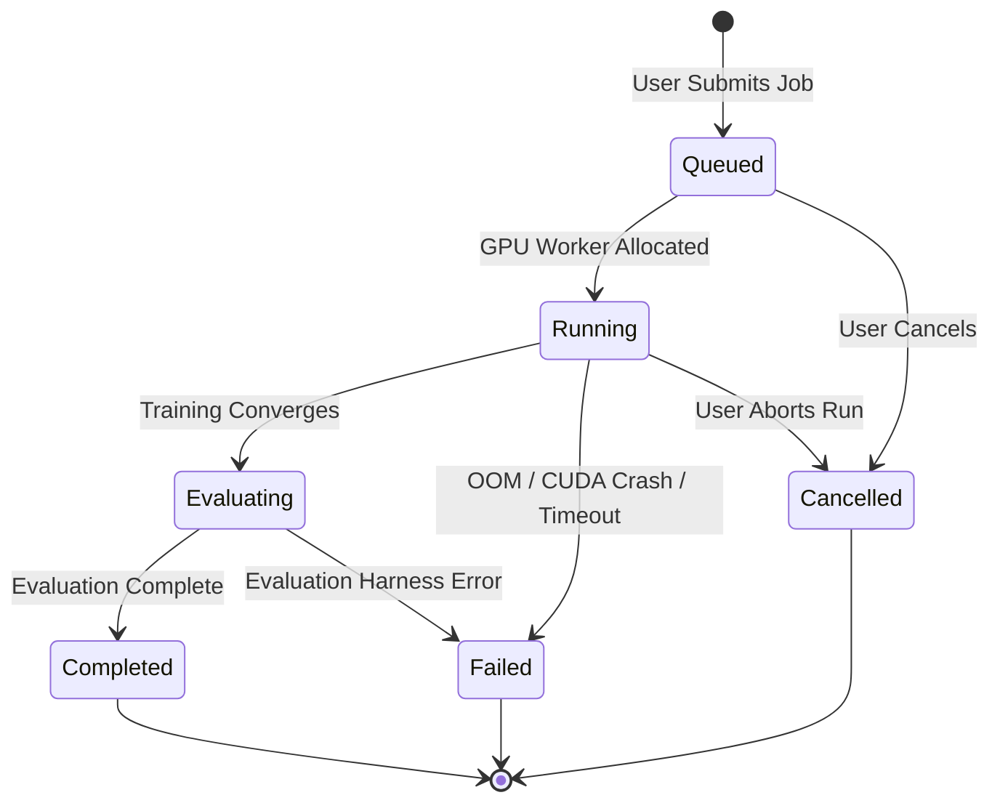
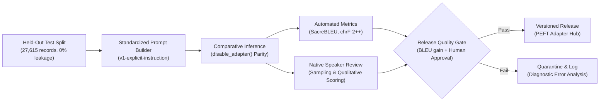

# 11 — Future Platform Vision & Implementation Roadmap

> **N-ATLaS Language Foundry — Strategic Engineering & Product Blueprint**  
> *Target Architecture, Multi-Language Variety Strategy, and Phased Execution Plan*  
> *Author: YiM Consulting Engineering Team*  
> *Document Status: Strategic Product & Technical Roadmap (Future Target Specification)*

---

## 1. Executive Summary

The long-term mission of the **N-ATLaS Language Foundry** is to provide reusable, auditable, and self-service **developer infrastructure** that democratizes the adaptation of Nigeria's sovereign foundation model, `NCAIR1/N-ATLaS`, to under-resourced Nigerian languages, regional dialects, and specialized domains.

Modern Large Language Models (LLMs) suffer from severe data imbalances. Nigeria's 500+ indigenous languages and numerous regional varieties are largely excluded from pretraining corpora or tokenized with severe inefficiencies. Today, adapting an 8-billion-parameter foundation model to an indigenous language is a fragmented, high-friction endeavor: individual researchers must manually write fragile preprocessing scripts, tackle unstandardized token masking, manage GPU allocations in opaque notebooks, and evaluate models with superficial metrics without linguistic grounding.

The N-ATLaS Language Foundry solves this structural bottleneck. Rather than serving as another bespoke fine-tuning experiment, the Foundry delivers an automated, transparent platform where:
1. **Datasets are audited, deduplicated, and partitioned** with mathematical guarantees against data leakage.
2. **Native speakers participate** via structured, privacy-preserving human-in-the-loop review workflows.
3. **Parameter-efficient adapters (PEFT/LoRA)** are trained, versioned, and catalogued with complete data lineage.
4. **Standardized comparative evaluations** objectively measure whether an adapted model genuinely improves task performance against the frozen base model.

### Prototype Reality vs. Intended Self-Service Platform

To ground future development in absolute engineering integrity, the platform distinguishes between the **current implementation** and the **target vision**:

```
┌────────────────────────────────────────────────────────────────────────┐
│                        Current Prototype Status                        │
├────────────────────────────────────────────────────────────────────────┤
│ • Validated Data Pipeline: Canonical builder, input-grouped splits     │
│ • Verified Tiv Evidence: Pinned MT560 dataset, REV_04 human reviews     │
│ • ML Training Mechanics: Assistant loss masking, collation, smoke run  │
│ • Evaluation Harness: Explicit prompt builder, SacreBLEU, chrF tests   │
│ • Control Plane: FastAPI metadata API (Render) & Next.js frontend      │
│ • Operational Mode: Manual CLI/Notebook orchestration & Docker API     │
└────────────────────────────────────┬───────────────────────────────────┘
                                     │
                                     ▼  [Future Evolution]
┌────────────────────────────────────────────────────────────────────────┐
│                  Target Self-Service Platform Vision                   │
├────────────────────────────────────────────────────────────────────────┤
│ • End-to-End Self-Service: Upload data ──► Click train ──► Get adapter  │
│ • Automated Job Orchestration: Celery/Redis queue & GPU worker pool   │
│ • Multi-Language & Variety Tree: Parent-child adapter lineages         │
│ • Durable Relational State: PostgreSQL database & S3 object storage   │
│ • Community Model Hub: Public versioned catalog of verified adapters  │
│ • Multi-Tenant Governance: Role-based access, quotas, and audit logs   │
└────────────────────────────────────────────────────────────────────────┘
```

The current prototype successfully establishes the foundational data contracts, loss masking invariants, evaluation methodology, and metadata APIs. This roadmap details the architecture, workflows, and phased milestones required to transform these validated components into an autonomous, multi-user developer platform.

---

## 2. Product Vision & Target User Experience

The target platform provides an intuitive, web-based developer portal where software engineers, computational linguists, and community organizations can adapt N-ATLaS without managing low-level GPU clusters, writing bespoke PyTorch collators, or wrestling with tokenizer special tokens.

### The 12-Step Target User Journey



1. **Project Creation & Language Selection**: A developer logs in, creates a project, and specifies the target language, regional variety (e.g., Central Tiv vs. Torov variety, or Standard Yoruba vs. Oyo dialect), and primary task (e.g., machine translation or instruction following).
2. **Dataset Upload & Provenance Registration**: The developer uploads a parallel corpus (JSONL, CSV, Parquet) or provides an upstream Hugging Face repository reference, attaching licensing declarations, author attributions, and collection methodology.
3. **Automated Quality Auditing**: The platform runs automated heuristic checks, flagging formatting errors, character encoding anomalies, unbalanced length ratios, exact duplicate pairs, and repeated source inputs.
4. **Guided Cleanup & Human Review Gating**: The platform generates a human-review sample queue for high-risk or ambiguous records. Qualified native speakers review translations via an interactive portal supporting regional diacritics and tone markers.
5. **Deterministic Split Generation**: Upon passing review thresholds, the platform builds an immutable dataset version and executes an input-grouped split (75/10/15) with an explicit seed, preventing identical source inputs from crossing train/test boundaries.
6. **Adaptive Configuration Recommendation**: Based on dataset volume, sequence length distribution, and available compute, the platform recommends an optimal LoRA recipe (rank, alpha, learning rate, target modules).
7. **One-Click Training Job Submission**: The developer clicks "Start Adaptation" without needing to write PyTorch training scripts or configure a Jupyter notebook.
8. **Asynchronous Compute Scheduling**: A background worker queue allocates an isolated GPU node, streams training logs, and renders real-time loss curves in the dashboard.
9. **Automated Comparative Evaluation**: Upon training completion, an evaluation worker runs greedy decoding across the held-out test split for both the frozen base model and the adapted model under identical prompt templates (`Translate the following English text into {Language}:\n{text}`).
10. **Results, Metric Diffs & Error Analysis**: The developer reviews SacreBLEU, chrF-2++, loss delta curves, and side-by-side translation predictions with reference targets.
11. **Versioned Adapter Export & Publication**: The developer downloads the trained PEFT adapter bundle (`adapter_model.safetensors`, `adapter_config.json`, model card) or publishes it directly to the Foundry Adapter Hub or Hugging Face Model Hub with verified provenance badges.
12. **Lineage Tracing & Incremental Adaptation**: Six months later, another team can reference this versioned adapter as a base parent checkpoint, performing domain-specific fine-tuning (e.g., agricultural or legal terminology) while maintaining complete ancestry tracking.

### Operational Reality vs. Target Experience
In the **current prototype**, Steps 3, 5, 6, and 9 exist as verified library modules and notebooks, but Steps 1, 2, 4, 7, 8, 11, and 12 require manual engineer orchestration via CLI commands, Python scripts, or cloud notebooks.

---

## 3. Nigerian Languages & Language-Variety Strategy

A foundational thesis of the N-ATLaS Language Foundry is that **general multilingual models fail low-resource communities when they treat distinct languages and regional dialects as homogeneous entities**.

Nigeria possesses extraordinary linguistic diversity spanning three major African language families (Niger-Congo, Afroasiatic, and Nilo-Saharan). Within major language groups, distinct regional varieties exhibit significant phonological, orthographic, and lexical divergences.

### Discerning When Separate Adapters Are Justified

The Foundry rejects the simplistic assumption that every regional accent or village dialect requires an independent 8-billion-parameter adapter. Training and maintaining separate model weights incurs significant data collection, evaluation, and compute costs. Instead, the Foundry enforces an **evidence-based variety adaptation framework**:

```
                              [ Target Language Community ]
                                            │
                                            ▼
                        Does the variety exhibit substantial lexical,
                        syntactic, or orthographic divergence from
                        the standardized language corpus?
                                    │               │
                                   YES              NO
                                    │               │
                                    │               ▼
                                    │       [ Unified Base Adapter ]
                                    │       Train a single robust language
                                    │       adapter across pooled corpora.
                                    ▼
                 Does empirical comparative evaluation show that the
                 unified adapter fails or produces unnatural outputs on
                 this specific variety?
                                    │               │
                                   YES              NO
                                    │               │
                                    ▼               ▼
                        [ Dedicated Variety Adapter ] [ Shared Adapter with ]
                        Train a specialized child     [ Lexical Augmentation]
                        adapter branched from the
                        language base adapter.
```

### Taxonomy & Linguistic Identifiers

In the target platform, every project must define a structured linguistic identifier hierarchy:

| Level | Identifier Example | Description & Scope |
| :--- | :--- | :--- |
| **Language Family** | `niger-congo` | Broad phylogenetic classification. |
| **Subfamily / Branch**| `benue-congo.tivoid` | Structural genetic grouping. |
| **Macrolanguage / Language** | `tiv` (ISO 639-3) | Primary linguistic classification. |
| **Variety / Dialect** | `tiv-torov` / `tiv-iharev` | Regional or sociolinguistic variety (Hypothetical specification). |
| **Orthography System** | `latn-standard-1980` | Official Latin script with modern tone orthography. |

### Parent-Child Adapter Lineages (Incremental Specialization)

Rather than training every variety adapter from the raw N-ATLaS base model, the Foundry architecture supports **hierarchical adapter inheritance**:



*Note: The Igbo variety adapters above are hypothetical architectural examples demonstrating the planned parent-child lineage model, not existing model weights.*

### Cross-Variety Transferability & Risk Mitigation
Treating language varieties as interchangeable introduces severe risks:
1. **Linguistic Alienation**: Imposing a central standardized dialect on a peripheral community can generate translations perceived as culturally insensitive, archaic, or patronizing.
2. **Meaning Inversion & False Friends**: Regional lexical shifts can invert meanings or introduce offensive connotations in local contexts.
3. **Orthographic Incoherence**: Mixing competing spelling conventions in the same training corpus confuses the model's subword tokenizer, generating corrupted diacritics.

To mitigate these risks, the Foundry requires **human review by knowledgeable native speakers of that specific variety**, evaluating both local naturalness and mutual intelligibility against the standard language.

---

## 4. Target System Architecture

The target N-ATLaS Language Foundry is engineered as a distributed, service-oriented system comprising seven decoupled subsystems.



*Note: This diagram depicts the target production architecture. The currently deployed Render instance implements a lightweight, in-memory metadata control plane.*

### Subsystem Responsibilities

1. **Presentation Layer (Next.js 16 & CLI)**: Delivers responsive developer dashboards for managing dataset schemas, monitoring live loss streams, reviewing evaluation diffs, and triaging reviewer queues.
2. **Control Plane API (FastAPI)**: Manages authentication, schema validation, experiment orchestration, and metadata retrieval. Strictly decoupled from GPU hardware to guarantee 99.9% availability at low cost.
3. **Data Governance & Split Engine**: Asynchronous workers that parse multi-format uploads, prune duplicate pairs, calculate vocabulary distributions, enforce input grouping, and generate cryptographically signed split metadata.
4. **Human Review Service**: Manages reviewer queues, records multi-dimensional evaluation criteria (accuracy, naturalness, completeness, format), and computes inter-annotator agreement statistics.
5. **Orchestration & Compute Scheduler**: Coordinates job lifecycles (`queued → running → evaluating → completed`), schedules tasks across available GPU instances (cloud or on-premise), handles spot-instance preemption, and manages user resource quotas.
6. **ML Execution Plane**: Dedicated GPU container instances running PyTorch, Hugging Face Transformers, and PEFT. Executes assistant-only loss-masked training and standardized comparative evaluations.
7. **Storage Architecture**: Hybrid persistence utilizing PostgreSQL for relational integrity and transactional queries, and S3-compatible object storage for immutable datasets, checkpoints, and safetensors weights.

---

## 5. End-to-End Automated Workflow

The table below details the step-by-step technical lifecycle in the target platform, contrasting required automated behaviors with current implementation gaps:

| Stage | Developer Action | Automated Platform Behavior | Inputs & Outputs | Validation & Failure Safeguards | Persistent State Recorded | Current Prototype Status | Engineering Work Required |
| :--- | :--- | :--- | :--- | :--- | :--- | :--- | :--- |
| **1. Ingestion** | Uploads raw corpus file or supplies HF repo URI. | Normalizes columns into canonical schema `{id, input, target, language_code}`. | *In:* CSV/JSONL.<br/>*Out:* Canonical JSONL. | Rejects malformed UTF-8, null inputs, or unrecognized language tags. | Ingestion run ID, raw file SHA-256, byte count, timestamp. | **Implemented (CLI)** | Build web upload handler, chunked file streamer, and S3 bucket writer. |
| **2. Quality Audit** | Reviews automated audit summary on web UI. | Calculates exact duplicates, length ratio outliers, and repeated source inputs. | *In:* Canonical JSONL.<br/>*Out:* Audit manifest. | Flags extreme length ratios (>5.0 or <0.2); isolates identical inputs. | Duplicate record IDs, outlier indices, vocabulary counts. | **Implemented (CLI)** | Migrate standalone audit scripts into Celery background task worker. |
| **3. Review Triage** | Assigns review batches to certified linguists. | Generates stratified random sample (e.g., 50–200 pairs); routes to review queue. | *In:* Flagged records.<br/>*Out:* Sample queue. | Enforces native reviewer credentials; locks records during active review. | Reviewer ID, Likert scores, correction diffs, completion status. | **Partially Implemented** | Connect interactive web review UI to PostgreSQL persistence. |
| **4. Splitting** | Selects split strategy (default: `grouped_by_input`). | Partitions records (75/10/15) ensuring identical inputs remain in one split. | *In:* Cleaned corpus.<br/>*Out:* Train/val/test splits + metadata. | Fails if test set contains any normalized English input found in training. | Split ID, seed, partition counts, input group hashes. | **Implemented & Tested** | Expose split execution as background API endpoint. |
| **5. Configuration**| Selects adaptation target (LoRA) and base model. | Recommends batch size, gradient accumulation, and learning rate based on GPU. | *In:* User recipe.<br/>*Out:* Validated config. | Validates LoRA rank $r \le 64$, alpha $\alpha$, and target module existence. | Immutable experiment configuration manifest. | **Implemented & Tested** | Add configuration recommendation engine based on dataset size. |
| **6. Job Execution**| Clicks "Start Adaptation". | Scheduler claims GPU node, mounts data, initializes model, and trains. | *In:* Split URI + config.<br/>*Out:* Adapter safetensors. | Monitors GPU VRAM; recovers from OOM; saves intermediate checkpoints. | Per-step loss, learning rate, GPU memory, step timestamps. | **Available locally / Smoke tested** | Build Celery GPU task worker, node heartbeat, and cancel/retry handlers. |
| **7. Evaluation** | (Automated upon training completion). | Generates translations on test split using standardized prompt template. | *In:* Test split + weights.<br/>*Out:* Predictions & metrics. | Guarantees identical decoding settings and base model commit parity. | SacreBLEU, chrF-2++, prediction JSONL, inference latency. | **Implemented & Tested (Harness)** | Automate execution on remote GPU node following training completion. |
| **8. Publication** | Approves adapter release for team or public use. | Packages adapter bundle, generates model card, registers release tag. | *In:* Adapter weights.<br/>*Out:* Published model release. | Enforces minimum review approval and evaluation threshold before public release. | Release version, model card markdown, download permissions. | **Planned** | Implement Foundry Model Hub registry and Hugging Face export integration. |

---

## 6. Dataset Lifecycle, Provenance & Versioning

Data governance in low-resource African NLP demands stringent versioning. Modifying a dataset in-place or silently overwriting sentence pairs corrupts experimental reproducibility and invalidates longitudinal evaluations.

### The 7-Stage Immutable Dataset Lifecycle

```
[ Stage 1: Immutable Raw Source Snapshot ]  ──► Stored as s3://foundry-raw/{hash}.parquet
                 │
                 ▼
[ Stage 2: Canonicalized Record Stream ]    ──► Conforming to {id, input, target, language_code}
                 │
                 ▼
[ Stage 3: Automated Quality-Audit Artifact]──► Cryptographic hash, duplicate map, anomaly log
                 │
                 ▼
[ Stage 4: Human-Review Annotations ]       ──► Independent review sidecars with reviewer IDs
                 │
                 ▼
[ Stage 5: Accepted Dataset Version ]       ──► Immutable dataset release: tiv-mt560-v1
                 │
                 ▼
[ Stage 6: Deterministic Partition Splits ] ──► train.jsonl, val.jsonl, test.jsonl + split_metadata.json
                 │
                 ▼
[ Stage 7: Experiment Dataset Binding ]     ──► Pinned by split_id (tiv-mt560-v1-split-42)
```

### Empirical Tiv Pilot Evidence & Discrepancy Clarification

The verified facts from the Tiv pilot illustrate the necessity of rigorous lifecycle tracking:
* **Raw Source Corpus**: `michsethowusu/english-tiv_sentence-pairs_mt560` pinned to Hugging Face commit `252074f0d4c82c0005099b5eb4043fddc43026f1`.
* **Total Loaded Records**: `184,113`.
* **Understanding Duplicate Audits vs. Builder Pruning**:
  - The preliminary exploratory audit script reported **391 exact duplicate pairs** and **3,116 repeated English inputs** when performing loose whitespace and text normalization.
  - The production canonical dataset builder (`foundry/datasets/builder.py`) applies strict string-equality deduplication on the loaded records, pruning exactly **14 duplicate records** and retaining **184,099 clean records**.
  - The repeated English inputs (which share identical English phrases but possess different or contextualized Tiv translations) were preserved in the corpus rather than discarded, because multi-translation targets represent legitimate linguistic variation.
* **Sealed Grouped Split (`tiv-mt560-v1-split-42`)**:
  - Strategy: `grouped_by_input` with random seed `42`.
  - Partition Breakdown: **138,074 Train** (75.0%), **18,410 Validation** (10.0%), and **27,615 Test** (15.0%).
  - Input Leakage: Verified **0% overlap** of English source phrases across partitions.
* **Secondary Dataset Isolation (Hypa Text-10k)**:
  - An exploratory candidate set of 103 English-Tiv instruction pairs was identified in Hypa Text-10k.
  - In accordance with provenance rules, **Hypa candidate records have NOT been merged into the canonical MT560 training split**. They remain isolated pending formal linguistic verification.
* **Licensing & Legal Status**:
  - The MT560 corpus declares a `CC BY 4.0` license on Hugging Face.
  - In accordance with enterprise governance, formal attribution verification and upstream source terms remain classified as *Pending Verification* prior to commercial distribution.

---

## 7. Artifact & Storage Architecture

A production language adaptation platform generates large, heterogeneous data assets requiring clear storage boundaries, lifecycle policies, and access controls.

```
┌────────────────────────────────────────────────────────────────────────┐
│                        N-ATLaS Language Foundry                        │
└──────────────────┬─────────────────────────────────┬───────────────────┘
                   │                                 │
                   ▼                                 ▼
┌──────────────────────────────────────┐  ┌───────────────────────────────┐
│       Durable Object Storage         │  │      Relational Database      │
│    (AWS S3 / Cloudflare R2 / GCS)    │  │         (PostgreSQL)          │
├──────────────────────────────────────┤  ├───────────────────────────────┤
│ • s3://foundry-raw-sources/          │  │ • User Accounts & API Keys    │
│ • s3://foundry-canonical-datasets/   │  │ • Language & Variety Registry │
│ • s3://foundry-split-partitions/     │  │ • Dataset Metadata & Hashes   │
│ • s3://foundry-checkpoints/          │  │ • Review Scores & Audit Logs  │
│ • s3://foundry-adapters/             │  │ • Experiment Records & Status │
│ • s3://foundry-evaluations/          │  │ • S3 Artifact URIs & Lineage  │
└──────────────────┬───────────────────┘  └───────────────────────────────┘
                   │
                   ▼
┌────────────────────────────────────────────────────────────────────────┐
│                      Public Distribution Channels                      │
├────────────────────────────────────┬───────────────────────────────────┤
│    Hugging Face Dataset Repos      │      Hugging Face Model Hub       │
│    (Curated, permitted corpora)    │   (Approved, versioned adapters)  │
└────────────────────────────────────┴───────────────────────────────────┘
```

### Storage Boundaries & Media Classification

| Storage Tier | Technology | Data Stored | Access Policy & Retention | Anti-Pattern to Avoid |
| :--- | :--- | :--- | :--- | :--- |
| **Object Storage** | AWS S3, Cloudflare R2, Google Cloud Storage | Raw corpora, processed JSONL splits, intermediate checkpoints, final LoRA weights (`adapter_model.safetensors`), evaluation prediction files. | Private-by-default; pre-signed URLs for downloads; lifecycle rules auto-delete intermediate checkpoints after 30 days. | **NEVER** store binary weights or multi-gigabyte datasets in relational database tables. |
| **Relational Database** | PostgreSQL 16 with SQLAlchemy & Alembic | User profiles, organizations, language taxonomies, dataset metadata, review ratings, experiment status, execution timestamps, S3 URIs. | ACID-compliant; automated daily backups; row-level security per project. | **NEVER** store raw dataset sentence records as individual database rows. |
| **Public Datasets Hub** | Hugging Face Datasets | Standardized, permission-cleared corpora intended for open scientific research. | Public access; version-pinned git commits; verified license badges. | **NEVER** upload corpora with unverified licensing or containing private user data. |
| **Public Models Hub** | Hugging Face Model Hub | Approved, validated LoRA adapter releases passing quality gates. | Public access; model cards containing dataset lineage, evaluation BLEU scores, and prompt templates. | **NEVER** publish adapters from smoke tests or unverified evaluations. |
| **Code Repository** | Git / GitHub | Application code, FastAPI routes, Next.js UI, schemas, test suites, Dockerfiles, small sanitized manifests. | Version-controlled; pull-request reviews. | **NEVER** commit `.xlsx` spreadsheets, JSONL corpora, or `.safetensors` model weights to Git. |

### Note on Google Drive Prototype Storage
During initial exploratory development, Google Drive was utilized to exchange dataset snapshots and Colab checkpoint files. While convenient for exploratory prototyping, Google Drive lacks programmatic access controls, cryptographic integrity verification, atomic streaming, and automated lifecycle policies. It is explicitly designated as a temporary prototype mechanism, not the production architecture.

### Logical Experiment Artifact Directory Structure

In the target platform, every adaptation and evaluation job produces an immutable, self-contained run package stored in object storage and referenced by UUID in PostgreSQL:

```text
s3://foundry-experiments/exp-2026-tiv-lora-v1/
├── manifest.json              # Run UUID, base model revision, split ID, timestamps, user ID
├── training_config.json       # Exact hyperparameters (r=16, alpha=32, lr=1e-4, batch=1, accum=8)
├── training_metrics.json      # Step-by-step training loss, validation loss, learning rate curve
├── logs/
│   ├── train.log              # Stdout/stderr console output and CUDA environment diagnostics
│   └── events.out.tfevents    # TensorBoard scalar traces for real-time visualization
├── adapter/
│   ├── adapter_config.json    # Standard Hugging Face PEFT LoRA configuration
│   ├── adapter_model.safetensors # Trained low-rank delta tensors (~27 MB)
│   ├── special_tokens_map.json# Tokenizer special tokens mapping
│   └── README.md              # Auto-generated model card with training recipe and data lineage
└── evaluation/
    ├── harness_manifest.json  # Pinned base commit, prompt template, decoding parameters
    ├── predictions.jsonl      # Test prompt, reference target, base output, adapter output
    └── metrics.json           # SacreBLEU, chrF-2++, exact match, latency metrics
```

---

## 8. Training Orchestration & Compute Strategy

Training an 8-billion-parameter model—even with parameter-efficient techniques—cannot be executed synchronously within an HTTP API request. The target platform orchestrates adaptation as an asynchronous background workflow.

### Background Job Lifecycle State Machine



### Hardware Constraints & Tesla T4 Engineering Strategy

The Tesla T4 (16GB VRAM) represents the target baseline cloud accelerator (widely available on Google Colab, Kaggle, and low-cost cloud instances). Adapting N-ATLaS on a T4 imposes strict engineering boundaries:

1. **Parameter Quantization vs. Precision**:
   * Storing 8 billion parameters in 16-bit half-precision (`float16` or `bfloat16`) consumes approximately **16 GB of VRAM** for weights alone, triggering immediate Out-Of-Memory (OOM) errors during the backward pass.
   * On a single 16GB T4, the model must be loaded in **8-bit** (via `bitsandbytes` LLM.int8()) or **4-bit** (NF4 via QLoRA). The repository currently implements and verifies the 8-bit loading path (`prepare_model_for_kbit_training`), reducing base model memory to ~9.24 GB and leaving ~6.5 GB for LoRA adapter gradients and activation tensors.
   * *QLoRA Note*: 4-bit QLoRA remains classified as *Planned* until a quantized loading and backward pass path is formally implemented and verified in the test suite.
2. **Batching and Sequence Clamping**:
   * Per-device training batch size is clamped to `1`, utilizing gradient accumulation steps (`8` to `16`) to emulate effective batch sizes of 8–16 without memory spikes.
   * Maximum sequence length is constrained to `256` or `512` tokens. Overlength records are filtered during preprocessing rather than truncated mid-sentence.
3. **Execution Runtime Profile**:
   * Full training across the 138,074 records in `tiv-mt560-v1` requires ~8,600 optimizer steps (with batch size 1 and gradient accumulation 16).
   * On a T4, processing 1 step (16 forward/backward passes) requires ~1.5–2.2 seconds. A full epoch requires **18–28 hours** of continuous compute. Multi-epoch production runs therefore target higher-throughput accelerators (e.g., NVIDIA A10G or A100) or multi-GPU distributed clusters.

### Compute Workload Partitioning

To optimize costs, the platform strictly segregates workloads:
* **CPU Only (Zero GPU Required)**: FastAPI control plane, Next.js web frontend, PostgreSQL metadata updates, dataset schema normalization, duplicate auditing, input-grouped splitting, and unit testing.
* **Low-Cost GPU (Tesla T4 / Colab / Kaggle)**: Integration smoke tests, 4-step backward pass validation, template verification, and small-batch inference.
* **High-Capacity GPU (NVIDIA A10G, A100, H100)**: Multi-epoch adapter training on 100k+ pairs, large-scale batch evaluation across 27,000 test records, and high-throughput multi-tenant serving.

---

## 9. Evaluation, Human Review & Release Quality

The guiding ethical principle of the Foundry is: **"Do Not Invent Improvement."** 

Parameter-efficient fine-tuning on noisy or narrow low-resource datasets can easily degrade a model's foundational capabilities, induce hallucination, or overfit to repetitive phrases. The target platform enforces a rigorous release gate before any adapter can be published or recommended.



### The Standardized Evaluation Harness

To prevent metric inflation and ensure scientific parity:
1. **Pinned Base Model Revision**: Evaluation always resolves `NCAIR1/N-ATLaS` to exact commit SHA `e294476928aca9030e924ca27bb8e085e8581273`.
2. **Explicit Instruction Format**: Prompts are constructed using the verified template:
   ```text
   Translate the following English text into Tiv:
   {text}
   ```
   *Methodological Fix*: The earlier diagnostic smoke run omitted this task instruction, causing N-ATLaS to interpret English inputs as conversational prompts and reply in English. The corrected harness enforces task framing by design.
3. **Reference Target Exclusion**: Reference translations are strictly isolated from the input prompt string.
4. **Decoding Parity**: Both base and adapted configurations run on identical loaded model weights with identical greedy decoding parameters (`do_sample=False`, `max_new_tokens=128`, padding token set to EOS). The unadapted baseline is evaluated dynamically via `model.disable_adapter()`.

### Qualitative Human Review Integration

Automated metrics like SacreBLEU are notoriously imperfect for tonal African languages with rich agglutinative morphology or flexible word order. In the target platform:
* A random sample of 50–100 generated model predictions is submitted to native speaker reviewers.
* Reviewers evaluate four standardized dimensions:
  1. **Translation Accuracy** (1–5 Likert scale)
  2. **Meaning Completeness** (Binary Yes/No)
  3. **Tiv Naturalness** (1–5 Likert scale)
  4. **Format Acceptability** (Binary Yes/No)
* Reviewers tag qualitative error flags: loanword over-reliance, syntactic word order errors, tone marker omissions, and cultural inaccuracies.

---

## 10. Security, Governance & Multi-User Operations

Transforming the Foundry into a multi-tenant platform requires comprehensive operational security:

1. **Authentication & Authorization**:
   * JWT-based authentication via OAuth2 (supporting GitHub and Google social login).
   * Role-Based Access Control (RBAC): *Viewer*, *Annotator*, *Developer*, *Project Admin*, and *Platform Admin*.
2. **Tenant Isolation**:
   * Project data segregation: Datasets, manifests, and runs belong to isolated workspaces.
   * Container sandbox isolation: GPU training workers run inside unprivileged, ephemeral Docker containers without host network or host filesystem mounts.
3. **Safe File Upload & Validation**:
   * File upload size limits (e.g., 250 MB maximum per raw file).
   * Strict MIME-type and encoding validation: All uploads are parsed as strict UTF-8 text to prevent binary execution or script injection.
4. **Data Sovereignty & Licensing Governance**:
   * Mandatory licensing metadata: Users must explicitly declare the upstream source license before dataset activation.
   * Copyright compliance flags: The platform blocks public publication of datasets with restrictive, non-commercial, or unverified licenses.
5. **Reviewer Privacy Protection**:
   * Evaluator anonymization: Reviewer email addresses, personal names, and hourly rates are stripped from public evidence APIs, referencing only randomized pseudonyms (e.g., `REV_04`).
6. **Abuse Prevention & Resource Quotas**:
   * Compute budgets: Configurable GPU-hour limits per user account to prevent compute exhaustion.
   * API rate limiting: Token-bucket rate limiting across public control-plane endpoints.

---

## 11. Current Prototype: Implemented Capabilities & Limitations

The table below provides a factual audit of the codebase as of Checkpoint E:

| Capability / Area | Status | Verification Evidence | Operational Scope & Remaining Gap |
| :--- | :--- | :--- | :--- |
| **Language Registry** | **Implemented** | Route `GET /api/v1/languages`; tests in `test_language_schema.py`. | Dynamic in-memory registry for Tiv (`tiv`). Needs PostgreSQL persistence. |
| **Dataset Ingestion & Splitter** | **Implemented** | `foundry/datasets/builder.py`; tests in `test_dataset_builder.py`. | CLI deduplication and `grouped_by_input` algorithm. Needs web upload handler. |
| **Split Discovery** | **Implemented** | Manifest `tiv_split_metadata.json`; API route `GET /api/v1/splits/{id}`. | Discovers disk partitions and manifests. Needs S3-backed partition store. |
| **Human Review Evidence** | **Implemented** | Manifest `tiv_human_review_evidence.json`; route `GET /api/v1/.../review-evidence`. | Serves 51 verified annotations from `REV_04`. Interactive queue is currently empty. |
| **Interactive Review Storage** | **Partially Implemented** | Route `POST /api/v1/review/decision`; test suite. | Stores decisions in container process memory. Decisions do not survive container restarts. |
| **Loss Masking Preprocessing** | **Implemented & Tested** | `foundry/training/preprocessing.py`; tests in `test_natlas_preprocessing.py`. | Assistant-only `-100` label masking and prefix assertion verified in 10 tests. |
| **Dynamic Collation** | **Implemented & Tested** | `foundry/training/collator.py`; tests in `test_natlas_preprocessing.py`. | Right-padding to batch max length with `<|eot_id|>` token verified with PyTorch. |
| **Training Runner** | **Available locally / Smoke tested** | `foundry/training/runner.py`; tests in `test_natlas_training_runner.py`. | Verified via 4-step optimizer smoke run. Full multi-epoch training requires GPU compute. |
| **Evaluation Harness** | **Implemented & Tested** | `foundry/evaluation/harness.py`; tests in `test_evaluation_harness.py`. | Standardized prompt template and reference exclusion verified. Live GPU run deferred. |
| **Comparative Evaluation Results** | **Requires Validation** | Audit report in `05-experiment-and-evaluation.md`. | Smoke test BLEU/chrF invalidated by prompt defect; benchmark re-evaluation pending. |
| **Experiment Registry** | **Implemented** | Schema tests in `test_experiment_schema.py`. | Returns clean empty state `[]` to prevent fake data pollution. Needs persistent DB. |
| **Inference Playground** | **Implemented (Transparent)** | Route `POST /api/v1/playground/generate`. | Returns intentional `503 Service Unavailable` with descriptive message on demo tier. |
| **Public Deployment** | **Implemented** | Render Web Service: `https://yim-n-atlas-language-foundry.onrender.com`. | Dynamic port binding, CORS configured, read-only demo guard active. |

---

## 12. Phased Implementation Roadmap

The transition from the current prototype to a production self-service platform is structured across four sequential engineering phases:

```
┌────────────────────────────────────────────────────────────────────────┐
│ Phase A: Reliable Single-User Pipeline                                  │
│ Milestone: Complete reproducible CLI/API adaptation & verified eval   │
└───────────────────────────────────┬────────────────────────────────────┘
                                    │
                                    ▼
┌────────────────────────────────────────────────────────────────────────┐
│ Phase B: Automated Asynchronous Execution                              │
│ Milestone: Background worker queue, GPU scheduling, & checkpoint recovery│
└───────────────────────────────────┬────────────────────────────────────┘
                                    │
                                    ▼
┌────────────────────────────────────────────────────────────────────────┐
│ Phase C: Self-Service Multi-User Platform                              │
│ Milestone: User auth, project workspaces, & Foundry Adapter Hub        │
└───────────────────────────────────┬────────────────────────────────────┘
                                    │
                                    ▼
┌────────────────────────────────────────────────────────────────────────┐
│ Phase D: Production Operations & Dialect Scaling                       │
│ Milestone: Multi-tenant quotas, dynamic serving, & cross-variety models │
└────────────────────────────────────────────────────────────────────────┘
```

### Phase A: Reliable Single-User Pipeline (Target: Months 1–2)
* **Objective**: Eliminate all manual notebook interventions, establish durable relational persistence, and complete the live benchmark re-evaluation of the Tiv adapter.
* **Core Deliverables**:
  - Deploy PostgreSQL database with SQLAlchemy models and Alembic migrations.
  - Implement durable storage for review decisions, split metadata, and experiment records.
  - Integrate S3-compatible object storage (Cloudflare R2 or AWS S3) for dataset and artifact storage.
  - Execute live GPU benchmark re-evaluation across 1,000 held-out Tiv test records using the corrected evaluation harness.
* **Acceptance Criteria**:
  - Review submissions survive container restarts.
  - Ground-truth BLEU/chrF comparative evaluation metrics recorded in experiment registry.
  - Zero manual notebook execution required for data preparation and evaluation.

### Phase B: Automated Asynchronous Execution (Target: Months 3–4)
* **Objective**: Build distributed background worker infrastructure to manage training and evaluation lifecycles asynchronously.
* **Core Deliverables**:
  - Deploy Redis and Celery for distributed task queuing.
  - Implement GPU worker service with heartbeat health probes, progress streaming, and OOM recovery.
  - Build automated checkpoint saving and job cancellation handlers.
  - Implement real-time WebSocket loss stream to frontend dashboard.
* **Acceptance Criteria**:
  - User submits training job via API; API returns HTTP 202 Accepted with job UUID.
  - Dashboard visualizes live loss curve without page refresh.
  - Training failures log actionable error messages to the database.

### Phase C: Self-Service Multi-User Platform (Target: Months 5–7)
* **Objective**: Transform the single-user pipeline into a multi-tenant platform with user authentication, team collaboration, and a versioned adapter registry.
* **Core Deliverables**:
  - Implement OAuth2 authentication (GitHub/Google) and project-level workspace isolation.
  - Build web-based dataset upload wizard with drag-and-drop file ingestion.
  - Launch Foundry Adapter Hub: Public catalog for browsing, searching, and downloading validated language adapters.
  - Support parent-child adapter inheritance for fine-tuning on top of existing adapters.
* **Acceptance Criteria**:
  - Independent teams cannot view or mutate each other's private datasets.
  - Community users can download PEFT adapter weights directly from the catalog.

### Phase D: Production Operations & Dialect Scaling (Target: Months 8–12)
* **Objective**: Enterprise scalability, resource accounting, high-throughput inference, and expansion to additional Nigerian language varieties.
* **Core Deliverables**:
  - Implement user compute quotas and usage accounting.
  - Ingest and validate corpora for Igala (`igl`), Berom (`bom`), and Yoruba dialects.
  - Deploy dynamic LoRA serving microservice (vLLM / Triton) capable of hot-swapping adapters per request.
  - Establish automated inter-annotator agreement scoring for human review queues.
* **Acceptance Criteria**:
  - System dynamically routes inference requests across multiple language adapters on a single base model instance.
  - Comprehensive Prometheus and Grafana operational monitoring active.

---

## 13. Infrastructure & Resource Requirements

The table below outlines the infrastructure specifications required across development phases:

| Infrastructure Category | Low-Cost Prototype (Current Setup) | Scalable Production Target (Phase D) |
| :--- | :--- | :--- |
| **Control Plane Web API** | 1 vCPU, 512 MB – 1 GB RAM (Render Free/Starter Tier). | 2–4 vCPUs, 4 GB RAM, auto-scaled across 2+ zones. |
| **Relational Database** | In-process Python dictionaries / SQLite. | Managed PostgreSQL (2 vCPUs, 8 GB RAM, 50 GB SSD). |
| **Message Queue / Cache**| None (synchronous in-memory). | Managed Redis cluster (1 GB RAM, high availability). |
| **Object Storage** | Local filesystem (`./data/`) & Google Drive. | AWS S3 / Cloudflare R2 (1–5 TB storage, CDN edge caching). |
| **Training Compute** | Ephemeral Google Colab / Kaggle (1x Tesla T4 16GB). | Cloud GPU Pool (1x–4x NVIDIA A10G 24GB or A100 40GB/80GB). |
| **Evaluation Compute** | Local CPU (mocked) or Colab T4. | Dedicated GPU worker (1x NVIDIA T4 or A10G). |
| **Model Serving / Inference**| Offline (HTTP 503 response). | High-throughput vLLM instance (1x NVIDIA A10G / L4). |
| **Observability & Logging** | Render stdout console logs. | Datadog / Grafana Cloud / Sentry error tracking. |

*Note: Precise financial cost estimates require selecting specific cloud vendors, measuring actual workload volumes, and defining community traffic profiles.*

---

## 14. Proposed Platform Success Metrics

To guide engineering evaluation and measure platform impact, the team defines ten key performance indicators:

1. **Dataset Ingestion Success Rate**: $\ge 95\%$ of valid parallel corpora parsed and normalized without engineer intervention.
2. **Job Completion Reliability**: $\ge 98\%$ of scheduled training runs finish without unhandled infrastructure crashes.
3. **Median Turnaround Time**: Under 4 hours from dataset upload to completed evaluation for standard 50k-pair corpora.
4. **Reproducibility Fidelity**: $100\%$ of completed runs reproduce bit-identical split partitions and deterministic configurations.
5. **Leakage Prevention**: $0.0\%$ input leakage between training and evaluation splits across all generated partitions.
6. **Linguistic Review Coverage**: $\ge 80\%$ of flagged structural anomalies reviewed by certified native speakers prior to release.
7. **Task-Specific Translation Gain**: Positive SacreBLEU and chrF-2++ improvement over the base N-ATLaS baseline on standardized test sets.
8. **Artifact Integrity**: $100\%$ of published adapters pass cryptographic checksum verification and Hugging Face PEFT loading tests.
9. **Catalog Growth**: Reusable, documented adapters released for $\ge 5$ distinct Nigerian languages within 12 months.
10. **External Developer Adoption**: $\ge 20$ active community projects adapting N-ATLaS utilizing Foundry infrastructure.

---

## 15. Open Strategic Decisions & Technical Risks

Prior to launching Phase B and C development, the core team must resolve several strategic engineering trade-offs:

1. **Object Storage Provider Selection**:
   * *Trade-off*: AWS S3 (industry standard, rich tooling) vs. Cloudflare R2 (zero egress fees, critical for distributing multi-gigabyte model weights).
   * *Status*: Under evaluation. R2 is currently preferred for model distribution due to cost efficiency.
2. **GPU Compute Orchestration**:
   * *Trade-off*: Managed serverless GPU providers (Modal, RunPod, Replicate) vs. Dedicated cloud compute (AWS EC2 `g5.xlarge`, GCP A100).
   * *Status*: Serverless GPU execution provides zero idle cost during development, while dedicated nodes provide predictable latency for production serving.
3. **Adapter Licensing & Commercialization Policy**:
   * *Trade-off*: Permissive open-source (Apache 2.0 / MIT) vs. Responsible AI / Non-Commercial restrictions (OpenRAIL).
   * *Status*: Dependent on upstream training corpus licensing (e.g., CC BY vs. non-commercial data sources).
4. **Human Reviewer Compensation & Incentivization**:
   * *Trade-off*: Volunteer community linguists vs. Paid professional annotators.
   * *Status*: Volunteer crowdsourcing is scalable but slow; professional linguistic partnerships are required for gold-standard validation benchmarks.
5. **Hosted Inference vs. Pure Model Hub**:
   * *Trade-off*: Maintaining expensive live GPU serving endpoints vs. Distributing weights for developers to self-host.
   * *Status*: Phase A–C will focus strictly on adapter distribution; hosted inference will be deferred to enterprise tiers in Phase D.

---

## 16. Final Engineering Recommendation

The N-ATLaS Language Foundry project stands at an important milestone. The hardest architectural challenges—**loss masking invariants, deterministic input grouping, dynamic collation, evaluation harness design, and truthful contract-backed APIs**—have been successfully solved, verified, and deployed on the live Render environment.

The immediate engineering priority is **not premature multi-user scaling, building payment systems, or expanding to twenty languages simultaneously**. 

The immediate next priority is:
1. **Executing Phase A**: Completing the live comparative evaluation on the held-out Tiv test split using the corrected evaluation harness in a dedicated GPU environment, recording ground-truth SacreBLEU and chrF metrics.
2. **Deploying PostgreSQL Persistence**: Transitioning in-memory review storage and experiment metadata to durable database tables.
3. **Automating the Single-User Loop**: Connecting the FastAPI backend directly to the training runner, enabling a single developer to run an adaptation end-to-end through the web interface.

By demonstrating a fully automated, verifiable adaptation loop on Tiv, the Foundry establishes a gold-standard engineering template. From that foundation, expanding N-ATLaS across Nigeria's linguistic heritage becomes a structured, repeatable, and scalable reality.
