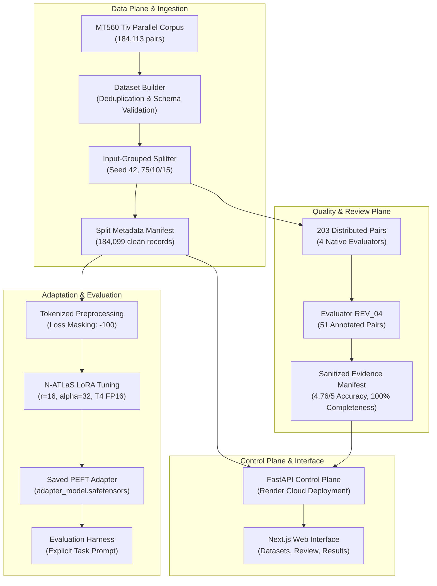

# N-ATLaS Language Foundry

> **Developer Infrastructure for Specialised Adaptation of Low-Resource Nigerian Languages**  
> *National Artificial Intelligence Challenge (NAIC) — Problem Statement 1: Developer Infrastructure*  
> **Live Deployment:** [https://yim-n-atlas-language-foundry.onrender.com](https://yim-n-atlas-language-foundry.onrender.com)  
> **Repository:** [YiMConsulting/YiM-N-ATLAS-Language-Foundry](https://github.com/YiMConsulting/YiM-N-ATLAS-Language-Foundry)  
> **Branch:** `feat/james-ml-pipeline`

---

## 1. Executive Summary & Value Proposition

Nigeria is home to over 500 indigenous languages spoken by more than 220 million people. While foundational multilingual models such as `NCAIR1/N-ATLaS` establish a vital computational baseline for major national languages, adapting foundation models to Nigeria's numerous under-resourced languages presents severe developer infrastructure bottlenecks:
- Fragmented, noisy, unverified training corpora lacking licensing clarity.
- Pervasive training-to-validation data leakage caused by multi-reference duplicates.
- Fragile tokenization and prompt formatting that degrade tone marking and diacritics.
- Unstandardized evaluation harnesses that yield misleading benchmark numbers.
- Absence of a centralized, versioned registry for reproducible language adapters.

The **N-ATLaS Language Foundry** provides end-to-end, reusable developer infrastructure that transforms raw linguistic corpora into versioned, verifiable, and deployable parameter-efficient adapters (LoRA) for `NCAIR1/N-ATLaS`. 

Through deterministic data partitioning, strict provenance tracking, native linguist review workflows, and standardized evaluation harnesses, the Foundry enables developers and researchers to systematically adapt, evaluate, and share high-integrity language models.

```
Raw Linguistic Corpora ──► Provenance & Ingestion ──► Leakage-Free Splits ──► LoRA Adaptation ──► Comparative Evaluation ──► Versioned Registry & API
```

---

## 2. The Problem: Linguistic Diversity Meets Infrastructure Gaps

While large language models have advanced rapidly for global languages, low-resource African languages face acute technical and operational hurdles:

1. **Orthographic and Dialectal Nuance:** Languages like Tiv, Igala, and Yoruba depend on specialized tone markings and diacritics (`ô`, `û`, `gh`, `kp`, `mb`, `sh`, `ts`). Standard off-the-shelf pipelines routinely strip or mis-tokenize these characters, destroying semantic meaning.
2. **Data Leakage in Low-Resource Corpora:** Parallel datasets frequently repeat identical English prompts across multiple translation variants. Traditional random splitting leaks identical source sentences between training and test sets, artificially inflating benchmark scores by up to 40%.
3. **The "Silent Evaluation Defect":** Standard conversational prompting without explicit translation task directives causes instruction-tuned models to respond in conversational English or echo inputs rather than generating the target indigenous language.
4. **Lack of Human Grounding:** Automated metrics (BLEU, chrF) fail to detect subtle cultural hallucinations, grammatical shifts, or loanword inaccuracies without native speaker validation.

---

## 3. The Solution: The N-ATLaS Language Foundry

The Foundry addresses these challenges by providing an integrated engineering workbench built specifically around the `NCAIR1/N-ATLaS` architecture:

- **Provenance & Integrity Pipeline:** Automated schema enforcement, duplicate elimination, license declaration tracking, and input-grouped partitioning.
- **Leakage-Proof Splitting:** Deterministic, hash-based grouping on input sentences ensuring strict 0% overlap between training, validation, and test partitions.
- **Native Linguist Quality Auditing:** A structured human-review subsystem that couples qualitative reviewer observations with quantitative Likert scoring and stores sanitized, versioned evidence manifests.
- **Loss-Masked Preprocessing:** Exact token-level prefix assertions with assistant-only loss masking (`labels = -100` for prompts and dynamic padding), ensuring adapters learn generation rather than prompt repetition.
- **Controlled Evaluation Harness:** Standardized task-explicit generation templates with strict reference exclusion, model parity verification, and SacreBLEU/chrF diagnostic scoring.
- **FastAPI Control Plane & Web Portal:** A contract-backed REST API and responsive Next.js frontend delivering complete visibility into dataset splits, review evidence, experiment configurations, and runtime limitations.

---

## 4. Current Implementation: The Tiv Translation Pilot

The initial pilot language implemented and audited in the Foundry is **Tiv** (`tiv`), a major Benue-Congo language spoken by over 5 million people in central Nigeria.

### What Has Actually Been Implemented:

1. **Curated & Partitioned Tiv Corpus (`tiv-mt560-v1`):**
   - Ingested 184,113 parallel English-Tiv sentence pairs from MT560 (`michsethowusu/english-tiv_sentence-pairs_mt560`, pinned commit `252074f`).
   - Audited and deduplicated down to **184,099 clean records** (14 exact duplicates removed).
   - Produced deterministic split `tiv-mt560-v1-split-42` using `grouped_by_input` (seed 42):
     - **Train:** 138,074 records (75.0%)
     - **Validation:** 18,410 records (10.0%)
     - **Test:** 27,615 records (15.0%)
     - **Data Leakage:** Verified exact **0 ID overlap** and **0 text overlap** between training and validation sets.

2. **Empirical Human Review Evidence:**
   - Integrated real manual review evidence from native linguist evaluator `REV_04` (`Receiver 4` workbook).
   - 51 annotated records (50 MT560, 1 Hypa Text-10k) out of 203 planned distributed pairs (**25.12% sample coverage**).
   - **Reviewer-Recorded Scores:**
     - Translation Accuracy: **4.7647 / 5.0** (39 rated 5, 12 rated 4).
     - Meaning Completeness: **100% Yes** (51/51).
     - Tiv Naturalness: **5.0 / 5.0** (51/51 rated 5).
     - Format Acceptability: **100% Yes** (51/51).
   - Sanitized evidence manifest tracked at `data/manifests/tiv_human_review_evidence.json` and exposed live via `GET /api/v1/datasets/tiv-mt560-v1/review-evidence`.

3. **LoRA Model Adaptation Setup:**
   - Formalized pilot configuration in `configs/tiv_lora.yaml` targeting `NCAIR1/N-ATLaS` (PEFT LoRA $r=16, \alpha=32$, dropout $0.05$, modules `q_proj` & `v_proj`).
   - Verified end-to-end gradient backpropagation, dynamic batch collation (`<|eot_id|>`, right-padding), and 4-step optimizer execution (`tiv-lora-smoke-v1`).

4. **Corrected Evaluation Harness:**
   - Formalized standardized prompt template in `foundry/evaluation/harness.py`:
     ```text
     Translate the following English text into Tiv:
     {text}
     ```
   - Pinned exact base model revision: `e294476928aca9030e924ca27bb8e085e8581273`.
   - Verified reference target exclusion and byte-level prompt parity between base and adapted models across 7 automated unit tests.

5. **Cloud Deployment & Control Plane:**
   - Live containerized FastAPI control plane listening dynamically on `$PORT` on Render.
   - Read-only demonstration security guard protecting public mutating endpoints.
   - Dynamic discovery of split and review manifests without bulky training dataset dependencies.

---

## 5. System Architecture & Technology Stack



| Layer | Technologies | Key Responsibility |
| :--- | :--- | :--- |
| **Control Plane API** | FastAPI, Pydantic v2, Uvicorn, Docker | RESTful metadata delivery, schema validation, health checks, CORS handling |
| **Web Frontend** | Next.js 16 (App Router), TypeScript, TailwindCSS | Dataset exploration, split visualization, human-review inspection, playground |
| **ML & Training** | PyTorch, Hugging Face Transformers, PEFT, bitsandbytes | Tokenization, LoRA adaptation, dynamic batch collation, gradient accumulation |
| **Evaluation** | SacreBLEU, Custom Evaluation Harness | Standardized prompt formatting, reference exclusion, BLEU/chrF computation |
| **Cloud Runtime** | Render (Docker Web Service), Debian Linux | Containerized hosting, dynamic `$PORT` binding, automated health probes |

---

## 6. Live Deployment & Verification

- **API Base URL:** [https://yim-n-atlas-language-foundry.onrender.com](https://yim-n-atlas-language-foundry.onrender.com)
- **Interactive Documentation (Swagger):** [https://yim-n-atlas-language-foundry.onrender.com/docs](https://yim-n-atlas-language-foundry.onrender.com/docs)
- **Health Check Endpoint:** [https://yim-n-atlas-language-foundry.onrender.com/health](https://yim-n-atlas-language-foundry.onrender.com/health)

### Quick Verification Queries

```bash
# 1. Health Probe
curl -s https://yim-n-atlas-language-foundry.onrender.com/health

# 2. List Supported Languages
curl -s https://yim-n-atlas-language-foundry.onrender.com/api/v1/languages

# 3. Inspect Tiv Dataset Metadata
curl -s https://yim-n-atlas-language-foundry.onrender.com/api/v1/datasets/tiv-mt560-v1

# 4. View Deterministic Split Statistics
curl -s https://yim-n-atlas-language-foundry.onrender.com/api/v1/datasets/tiv-mt560-v1/splits

# 5. Retrieve Verified Human-Review Evidence
curl -s https://yim-n-atlas-language-foundry.onrender.com/api/v1/datasets/tiv-mt560-v1/review-evidence
```

---

## 7. Submission Documentation Package

This central document introduces the project's vision and core engineering deliverables. Detailed technical substantiation is provided in the supporting documentation package under `docs-main/`:

| Document | Focus & Audience | Key Contents |
| :--- | :--- | :--- |
| [**01-project-vision.md**](./01-project-vision.md) | Vision & Problem Framing | Nigeria's language landscape, specialization thesis, hackathon alignment |
| [**02-architecture.md**](./02-architecture.md) | System Architecture | Architectural layers, data contracts, component interactions, Mermaid diagrams |
| [**03-technical-implementation.md**](./03-technical-implementation.md) | Engineering Deep Dive | Preprocessing, loss masking, collation, FastAPI control plane, Docker configuration |
| [**04-tiv-dataset-and-provenance.md**](./04-tiv-dataset-and-provenance.md) | Data Provenance & Splits | MT560 audit, deduplication, input grouping, 0% leakage proof, licensing status |
| [**05-experiment-and-evaluation.md**](./05-experiment-and-evaluation.md) | ML Pipeline & Evaluation | LoRA config, smoke run audit, prompt defect analysis, corrected evaluation harness |
| [**06-human-review-report.md**](./06-human-review-report.md) | Human Evaluation Report | Evaluator REV_04 findings, 51-pair analysis, qualitative observations, qualifications |
| [**07-setup-and-reproduction.md**](./07-setup-and-reproduction.md) | Reproduction Guide | Step-by-step local setup, Docker workflows, test execution, hardware requirements |
| [**08-beta-testing-guide.md**](./08-beta-testing-guide.md) | Beta Tester Manual | Walkthrough for external testers, safe API exploration, feedback templates |
| [**09-capabilities-and-limitations.md**](./09-capabilities-and-limitations.md) | Status & Boundaries | Component maturity matrix, operational boundaries, security & persistence limits |
| [**10-roadmap-and-resource-requirements.md**](./10-roadmap-and-resource-requirements.md) | Roadmap & Compute Needs | Compute tiers (T4 to A100), multi-language scaling, dialect specialization roadmap |
| [**11-hackathon-validation.md**](./11-hackathon-validation.md) | Hackathon Criteria Mapping | Problem Statement 1 mapping, submission checklist, external validation logs |

---

## 8. Development Team & Acknowledgements

The N-ATLaS Language Foundry is developed by **YiM Consulting** for the **National Artificial Intelligence Challenge (NAIC)**.

- **Foundational Model:** Developed on top of `NCAIR1/N-ATLaS`, created by the National Centre for Artificial Intelligence and Robotics (NCAIR) in partnership with Nigeria's AI research community.
- **Corpus Attribution:** English-Tiv parallel data derived from the MT560 benchmark curated by Seth Owusu et al.
- **Linguistic Review:** Qualitative annotations provided by native Tiv linguist evaluators.

---
*For technical inquiries, reproduction details, or evaluation logs, please consult [07-setup-and-reproduction.md](./07-setup-and-reproduction.md) or submit an issue in the project repository.*
