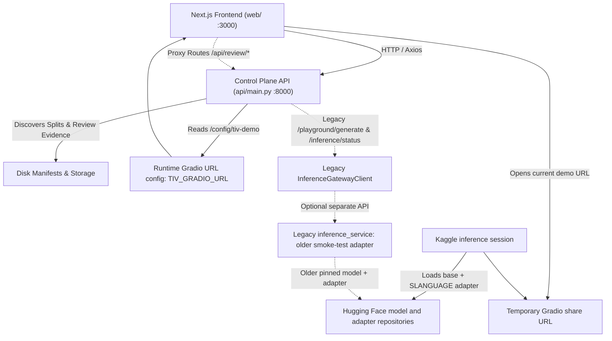

# N-ATLaS Language Foundry — API Contract & System Specification

**Status:** Control Plane v1, experimental Kaggle + Gradio demo, and retained legacy inference gateway
**Version:** `v1.2`
**Audience:** Frontend, backend/API, AI/ML, and integration contributors.

> **System Truthfulness Principle:**  
> The Foundry API is designed with strict transparency: it never fabricates model readiness, synthetic training progress, or simulated benchmark evaluations. Operational endpoints truthfully reflect backend and worker state (e.g., reporting HTTP 503 when GPU inference workers are offline rather than returning synthetic model translations).

---

## 1. System Architecture & Topology

The current experimental Tiv demo and the retained legacy inference API are
separate paths. The Kaggle + Gradio demo is the current demo workflow; the
standalone FastAPI inference service remains as legacy code and has not been
removed.

1. **Foundry Control Plane API (`api/main.py`):**
   - Built on FastAPI, running by default on port `8000`.
   - Manages language registries, processed dataset catalogs, deterministic split manifests, offline human review evidence, interactive review queues, experiment records, current demo URL configuration, and separate legacy inference proxy routing.
   - Dual-mounted route prefixes: All endpoints are accessible both with the `/api/v1` prefix and directly at root (e.g., both `/api/v1/languages` and `/languages`).
2. **Legacy Inference Microservice (`inference_service/app/main.py`):**
   - Provider-neutral standalone GPU-oriented service, not part of the current Kaggle + Gradio demo.
   - Its defaults target `NCAIR1/N-ATLaS` and the older adapter `YiMConsulting/n-atlas-tiv-lora-smoke-v1`; it has not been migrated to the experimental SLANGUAGE adapter.
   - Implements lazy model loading (weights are loaded only on the first generation call, never during startup or health probes).
   - The legacy Control Plane gateway connects to it via `InferenceGatewayClient` (`api/services/inference_client.py`). Those routes remain in the code and are distinct from the current demo.
3. **Frontend Application (`web/`):**
   - Built on Next.js 16 (App Router), React 19, and TailwindCSS v4.
   - Communicates with the Control Plane API via the typed Axios client in `web/lib/api-client.ts`.
   - Utilizes Next.js Route Handlers (`web/app/api/review/samples/route.ts` and `web/app/api/review/submit/route.ts`) for server-side proxying of review workflows when appropriate.
4. **Current experimental Tiv demo:** Kaggle loads the pinned base revision `e294476928aca9030e924ca27bb8e085e8581273` with `YiMConsulting/n-atlas-slanguage-tiv-qlora-experimental-v1` and serves the interface through a temporary Gradio share URL. The backend exposes its runtime-configured URL through `GET /api/v1/config/tiv-demo` (also `/config/tiv-demo`). Kaggle sessions and share URLs are temporary; this is not a permanently hosted inference service. Outputs are experimental and unvalidated. Use remains subject to the base-model and adapter repository terms and license conditions.



---

## 2. Base URLs, Security, & Operational Conventions

### Base URLs

- **Control Plane Local Default:** `http://localhost:8000/api/v1` (or `http://127.0.0.1:8000/api/v1`)
- **Frontend Environment Variable:**
  ```bash
  NEXT_PUBLIC_API_BASE_URL=http://localhost:8000/api/v1
  ```
- **Legacy inference API URL (Backend Env; separate from the current Gradio demo):**
  ```bash
  INFERENCE_SERVICE_URL=http://localhost:8001
  INFERENCE_TIMEOUT_SECONDS=45.0
  ```

### Dual-Mounting Convention

Every control plane route is registered with both root and `/api/v1` prefixes in `api/main.py`. For example:
- `GET /health` and `GET /api/v1/health`
- `GET /languages` and `GET /api/v1/languages`
- `GET /datasets` and `GET /api/v1/datasets`
- `POST /playground/generate` and `POST /api/v1/playground/generate`

Clients may use `/api/v1/...` (recommended) or root paths interchangeably.

### CORS Configuration

CORS is dynamically configured via `CORS_ORIGINS`:
- Defaults to wildcard `*` with credentials disabled.
- If explicit comma-separated origins are provided (e.g. `http://localhost:3000,https://foundry.example.com`), `allow_credentials=True` is enabled.

### Security, Demo Restrictions, & Secret Scrubbing

1. **Read-Only Demonstration Mode:**
   - Controlled by `READ_ONLY_MODE=true` (environment variable).
   - In read-only mode, public mutation endpoints (`POST /api/v1/review/decisions`, `POST /api/v1/review/submit`) reject requests with:
     ```json
     {
       "detail": "Public review submission is disabled in demonstration mode. The API is currently configured for read-only demonstration."
     }
     ```
     Status: `403 Forbidden`.
   - **Bypass for Administrators:** When `ADMIN_API_KEY` is set, passing the key via the `Authorization: Bearer <ADMIN_API_KEY>` header (or directly as `Authorization: <key>`) permits write operations even in read-only mode.
2. **Zero Secret Leakage Guarantee:**
   - The Inference Gateway client (`api/services/inference_client.py`) and Inference Microservice scrub all potential secrets from error messages using regex filters:
     - Hugging Face tokens (`hf_[a-zA-Z0-9_]{10,}` $\rightarrow$ `[REDACTED]`)
     - Bearer tokens (`Bearer [a-zA-Z0-9_\-\.]{10,}` $\rightarrow$ `Bearer [REDACTED]`)
     - Configured API keys and token parameters
     - Replaces raw stack traces with sanitized diagnostic messages.

### HTTP Status Code Standards

| Code | Meaning | Usage in Foundry |
| :--- | :--- | :--- |
| `200` | OK | Successful retrieval or query |
| `201` | Created | Successfully created decision record or batch |
| `400` | Bad Request | Missing query parameters (e.g. in proxy routes) |
| `401` | Unauthorized | Missing or invalid API key on secured services |
| `403` | Forbidden | Attempted write while `READ_ONLY_MODE` is active |
| `404` | Not Found | Resource (language, dataset, split, request) does not exist |
| `422` | Unprocessable Entity | Payload validation failure or invalid review decision value |
| `502` | Bad Gateway | Next.js API proxy failed to reach backend control plane |
| `503` | Service Unavailable | Upstream GPU inference service unreachable or model failed to load |

---

## 3. Shared TypeScript & Data Model Specifications

These contracts are synchronized across Pydantic schemas in `api/schemas/`, domain models in `foundry/`, and TypeScript definitions in `web/lib/api-client.ts`.

### 3.1 Language

**Backend:** `api.schemas.language.Language`, `LanguageStatus`  
**Frontend:** `LanguageDto`, `LanguageStatus`

```ts
export type LanguageStatus =
  | "discovered"
  | "registered"
  | "data_available"
  | "ready"
  | "adapting"
  | "adapted";

export interface Language {
  id: string;          // e.g. "lang-tiv-001"
  name: string;        // e.g. "Tiv"
  code: string;        // e.g. "tiv" (2-8 chars)
  description?: string | null;
  status: LanguageStatus;
  created_at: string;  // ISO-8601 UTC
  updated_at: string;  // ISO-8601 UTC
}
```

*Seeded Baseline:*
- `tiv`: Tiv (Pilot language, status: `data_available`)
- `igl`: Igala (Exploratory language, status: `discovered`)
- `yor`: Yoruba (Supported in base model, status: `discovered`)
- `ha`: Hausa (Supported in base model, status: `discovered`)
- `ibo`: Igbo (Supported in base model, status: `discovered`)

---

### 3.2 Dataset & Provenance

**Backend:** `api.schemas.dataset.Dataset`, `DatasetProvenance`, `DatasetFormat`, `DatasetSourceType`, `DatasetStatus`  
**Frontend:** `DatasetDto`, `DatasetStatus`

```ts
export type DatasetFormat = "jsonl" | "json" | "csv" | "tsv" | "parquet" | "txt";
export type DatasetSourceType = "research" | "community" | "institutional" | "private";
export type DatasetStatus =
  | "registered"
  | "provenance_checked"
  | "audited"
  | "reviewed"
  | "ready"
  | "rejected";

export interface DatasetProvenance {
  id: string;
  source_name: string;
  source_url?: string | null;
  license: string;
  version?: string | null;
  published_at?: string | null;
  retrieved_at: string;
  usage_allowed: boolean;
  usage_notes?: string | null;
  checksum?: string | null;
}

export interface Dataset {
  id: string;                      // e.g. "tiv-mt560-v1"
  language_code: string;           // e.g. "tiv"
  name: string;
  description?: string | null;
  format: DatasetFormat;
  source_type: DatasetSourceType;
  record_count?: number | null;    // 184099 for Tiv MT560
  local_path?: string | null;
  provenance_id: string;
  version?: string | null;
  status: DatasetStatus;
  created_at: string;
  updated_at: string;
  // Pilot-specific precomputed fields exposed in catalog:
  train_records?: number;
  validation_records?: number;
  test_records?: number;
  split_id?: string;
}
```

---

### 3.3 Dataset Split

**Backend:** `foundry.datasets.split.DatasetSplit`, `SplitStrategy`  
**Frontend:** `DatasetSplitDto`, `SplitStrategy`

```ts
export type SplitStrategy = "random" | "grouped_by_input";

export interface DatasetSplit {
  id: string;                  // e.g. "tiv-mt560-v1-split-42"
  dataset_id: string;          // e.g. "tiv-mt560-v1"
  strategy: SplitStrategy;     // "grouped_by_input" (leakage-preventing)
  seed: number;                // e.g. 42
  train_ratio: number;         // e.g. 0.75
  validation_ratio: number;    // e.g. 0.10
  test_ratio: number;          // e.g. 0.15
  total_records: number;       // 184099
  train_records: number;       // 138074
  validation_records: number;  // 18410
  test_records: number;        // 27615
  created_at: string;
}
```

*Validation Invariant:* Ratios sum to `1.0` within $10^{-6}$ tolerance; record counts sum exactly to `total_records`. Splits are automatically discovered at startup from `data/processed/*/split_metadata.json` or fallback manifest `data/manifests/tiv_split_metadata.json`.

---

### 3.4 Dataset Review Evidence (Offline Verification Pilot)

**Backend:** `api.schemas.review_evidence.DatasetReviewEvidence`, `MetricScoreSummary`, `ReviewerScopeSummary`  
**Frontend:** `DatasetReviewEvidenceDto`, `MetricScoreSummaryDto`, `ReviewerScopeSummaryDto`

Separates verified, completed offline native speaker audit results (loaded from `data/manifests/*_human_review_evidence.json`) from the interactive online review queue.

```ts
export interface MetricScoreSummary {
  metric_name: string;                 // e.g. "Translation Accuracy"
  scale: string;                       // e.g. "1-5" or "yes/no"
  description: string;
  mean_score?: number | null;          // e.g. 4.7647 (null for binary metrics)
  pass_count?: number | null;          // e.g. 51
  total_count: number;                 // e.g. 51
  score_distribution: Record<string, number>; // e.g. { "4": 12, "5": 39 }
}

export interface ReviewerScopeSummary {
  assigned_reviewers: string[];        // e.g. ["REV_01", "REV_02", "REV_03", "REV_04"]
  completed_reviewers: string[];       // e.g. ["REV_04"]
  pending_reviewers: string[];         // e.g. ["REV_01", "REV_02", "REV_03"]
}

export interface DatasetReviewEvidence {
  dataset_id: string;                  // e.g. "tiv-mt560-v1"
  language_code: string;               // e.g. "tiv"
  review_type: string;                 // "offline_manual_pilot"
  artifact_name: string;               // e.g. "Tiv Translation Pilot - Manual Review Distribution_2.xlsx"
  sheet_name: string;                  // e.g. "Receiver 4"
  status: string;                      // "in_progress"
  total_sampled_records: number;       // 203
  reviewed_records: number;            // 51
  pending_records: number;             // 152
  coverage_ratio: number;              // 0.2512
  sources_breakdown: Record<string, number>; // { "mt560": 50, "hypa": 1 }
  reviewer_scope: ReviewerScopeSummary;
  metrics: Record<string, MetricScoreSummary>;
  qualitative_findings: string[];
  qualification: string;               // Scope & verification disclaimer
  evaluated_at: string;
}
```

---

### 3.5 Interactive Human Review

**Backend:** `foundry.review.human_review` (`ReviewRequest`, `ReviewSampleItem`, `ReviewDecisionRecord`, `HumanReviewSummary`) and `api.main` (`SubmitDecisionRequest`, `BatchSubmitRequest`)  
**Frontend:** `ReviewRequestDto`, `ReviewSampleItemDto`, `ReviewDecisionRecordDto`, `SubmitDecisionPayload`, `BatchSubmitPayload`, `BatchSubmitResponseDto`, `HumanReviewSummaryDto`

```ts
export type ReviewRequestStatus = "pending" | "in_progress" | "completed" | "cancelled";
export type ReviewDecision = "correct" | "incorrect" | "needs_correction";

export interface ReviewRequest {
  id: string;
  dataset_id: string;
  reviewer_id?: string | null;
  sample_size: number;
  status: ReviewRequestStatus;
  created_at: string;
  updated_at?: string | null;
}

export interface ReviewSampleItem {
  id: string;
  review_request_id: string;
  record_id: string;
  input_text: string;
  expected_text: string;
  context?: string | null;
  flagged_reason?: string | null;
  sampled_at: string;
}

export interface ReviewDecisionRecord {
  id: string;
  review_request_id: string;
  sample_item_id: string;
  decision: ReviewDecision;
  reviewer_id?: string | null;
  corrected_text?: string | null;
  notes?: string | null;
  reviewed_at: string;
}

export interface SubmitDecisionRequest {
  review_request_id: string;
  sample_item_id: string;
  decision: ReviewDecision | "approved" | "rejected"; // "approved" normalized to "correct", "rejected" to "incorrect"
  reviewer_id?: string;
  corrected_text?: string | null;
  notes?: string | null;
}

export interface BatchSubmitRequest {
  dataset_id: string;
  reviewer_id: string;
  decisions: Array<{
    sample_id?: string;
    sample_item_id?: string;
    decision: ReviewDecision | "approved" | "rejected";
    suggested_correction?: string;
    corrected_text?: string;
    comment?: string;
    notes?: string;
    review_request_id?: string;
  }>;
  submitted_at?: string;
}

export interface BatchSubmitResponse {
  status: "success";
  dataset_id: string;
  reviewer_id: string;
  processed_decisions: number;
  message: string;
  timestamp: string;
}

export interface HumanReviewSummary {
  review_request_id: string;
  total_reviewed: number;
  correct_count: number;
  incorrect_count: number;
  needs_correction_count: number;
  pass_rate: number;         // percentage [0.0, 100.0]
  status: "completed" | "in_progress";
}
```

---

### 3.6 Experiment & Configuration

**Backend:** `api.schemas.experiment.Experiment`, `AdaptationConfig`, `TrainingConfig`, `RuntimeConfig`, `EvaluationMetrics`, `ExperimentArtifacts`  
**Frontend:** `ExperimentDto`

```ts
export type ExperimentStatus = "queued" | "running" | "evaluating" | "completed" | "failed";
export type AdaptationMethod = "lora" | "qlora";

export interface AdaptationConfig {
  method: AdaptationMethod;    // "lora" (QLoRA deliberately disabled in MVP runtime)
  rank: number;                // default 16
  alpha: number;               // default 32
  dropout: number;             // default 0.05
  target_modules: string[];    // default ["q_proj", "v_proj"]
}

export interface TrainingConfig {
  per_device_batch_size: number;      // default 4
  gradient_accumulation_steps: number; // default 4
  learning_rate: number;              // default 2e-4
  epochs: number;                     // default 3
  warmup_ratio: number;               // default 0.0
  weight_decay: number;               // default 0.0
  seed: number;                       // default 42
}

export interface RuntimeConfig {
  hardware: string;            // e.g. "Tesla T4"
  device: string;              // "cuda"
  precision: string | null;    // "bf16" or "fp16"
}

export interface EvaluationMetrics {
  loss?: number | null;
  bleu_score?: number | null;
  chrf_score?: number | null;
  exact_match_ratio?: number | null;
  inference_latency_ms?: number | null;
  sanity_check_passed: boolean;
  sample_outputs: Array<Record<string, string>>;
}

export interface ExperimentArtifacts {
  adapter_path?: string | null;
  config_path?: string | null;
  metrics_path?: string | null;
  logs_path?: string | null;
}

export interface Experiment {
  id: string;
  language_code: string;
  base_model: string;          // "NCAIR1/N-ATLaS"
  dataset_ids: string[];
  split_id: string;
  adaptation: AdaptationConfig;
  training: TrainingConfig;
  runtime: RuntimeConfig;
  status: ExperimentStatus;
  base_results?: EvaluationMetrics | null;
  adapted_results?: EvaluationMetrics | null;
  artifacts: ExperimentArtifacts;
  git_commit?: string | null;
  created_at: string;
  updated_at?: string | null;
}
```

---

### 3.7 Inference Gateway & Playground

**Backend:** `api.schemas.inference.PlaygroundRequest`, `PlaygroundResponse`, `InferenceStatusResponse`  
**Frontend:** `PlaygroundRequest`, `PlaygroundResponse`

```ts
export interface PlaygroundRequest {
  prompt: string;              // 1 to 4000 characters; non-empty
  language_code?: string;      // default "tiv"
  experiment_id?: string | null;
  max_new_tokens?: number;     // 1 to 256; default 64
  do_sample?: boolean;         // default false
}

export interface PlaygroundResponse {
  generated_text: string;      // Model output text
  prompt: string;              // Source English input text
  rendered_prompt?: string | null; // Exact instruction formatted for model
  language_code: string;       // "tiv"
  model: string;               // Base model repo id (for backward-compatibility)
  base_model: string;          // "NCAIR1/N-ATLaS"
  base_revision: string;       // "e294476928aca9030e924ca27bb8e085e8581273"
  adapter_repo: string;        // "YiMConsulting/n-atlas-tiv-lora-smoke-v1"
  adapter_revision: string;    // "d413bebb74ef3b971eacdd62d6bc10e75654914a"
  model_status: string;        // "smoke_test_preview"
  is_smoke_test_preview: boolean; // true
  disclaimer: string;          // Mandatory governance disclaimer
  latency_ms: number;          // Measured round-trip execution latency
  experiment_id?: string | null;
}

export interface InferenceStatusResponse {
  available: boolean;          // Whether upstream inference microservice is reachable
  model_loaded: boolean;       // Whether weights are confirmed in GPU/system memory
  message?: string | null;     // Diagnostic or error message
  base_model: string;          // "NCAIR1/N-ATLaS"
  base_revision: string;       // Pinned commit SHA
  adapter_repo: string;        // Pinned LoRA repository
  adapter_revision: string;    // Pinned LoRA commit SHA
  model_status: string;        // "smoke_test_preview"
  is_smoke_test_preview: boolean; // true
  quality_validated: boolean;  // false (explicitly guarantees quality is unverified)
  disclaimer: string;
  device?: string | null;      // e.g. "cuda" or "cpu"
  torch_dtype?: string | null; // e.g. "bfloat16"
  quantization?: string | null;// e.g. "none"
}
```

---

### 3.8 Shared List Envelope

All list endpoints return a uniform envelope:

```ts
export interface ApiListResponse<T> {
  items: T[];
  total: number;
}
```

*(Endpoints returning additional metadata include it at root, e.g., `/review/requests/{id}/samples` adds `review_request_id`).*

---

## 4. Master Endpoint Implementation Status

| Method | Route Path | Dual Root Path | Description | Implementation Status | Frontend Integration |
| :--- | :--- | :--- | :--- | :--- | :--- |
| `GET` | `/api/v1/health` | `/health`, `/healthz` | Process liveness & health | **Implemented & Verified** | Status bar / probes |
| `GET` | `/api/v1/` | `/` | API service discovery info | **Implemented & Verified** | Discovery link |
| `GET` | `/api/v1/languages` | `/languages` | List registered languages | **Implemented & Verified** | `/languages` page |
| `GET` | `/api/v1/languages/{code}` | `/languages/{code}` | Get language by ISO code | **Implemented & Verified** | `foundryApi.getLanguage` |
| `GET` | `/api/v1/datasets` | `/datasets` | List processed datasets | **Implemented & Verified** | `/datasets` page |
| `GET` | `/api/v1/datasets/{id}` | `/datasets/{id}` | Get dataset by ID | **Implemented & Verified** | `/datasets/[id]` page |
| `GET` | `/api/v1/splits/{id}` | `/splits/{id}` | Get split metadata by ID | **Implemented & Verified** | `foundryApi.getSplit` |
| `GET` | `/api/v1/datasets/{id}/splits` | `/datasets/{id}/splits` | List splits for a dataset | **Implemented & Verified** | `/datasets/[id]` SplitBar |
| `GET` | `/api/v1/datasets/{id}/review-evidence` | `/datasets/{id}/review-evidence` | Get offline review evidence | **Implemented & Verified** | `/datasets/[id]`, `/evidence`, `/review` |
| `GET` | `/api/v1/review/requests` | `/review/requests` | List active review requests | **Implemented & Verified** | `/review` ReviewPortal |
| `GET` | `/api/v1/review/requests/{id}` | `/review/requests/{id}` | Get review request by ID | **Implemented & Verified** | `foundryApi.getReviewRequest` |
| `GET` | `/api/v1/review/requests/{id}/samples` | `/review/requests/{id}/samples` | Get sample items for review | **Implemented & Verified** | `/review`, `/api/review/samples` |
| `POST` | `/api/v1/review/decisions` | `/review/decisions` | Submit single review decision | **Implemented & Verified** | Single review actions |
| `POST` | `/api/v1/review/submit` | `/review/submit`, `/api/reviews/submit` | Submit batch review decisions | **Implemented & Verified** | `/review` Batch submit, `/api/review/submit` |
| `GET` | `/api/v1/review/requests/{id}/summary` | `/review/requests/{id}/summary` | Aggregate review metrics | **Implemented & Verified** | `foundryApi.getReviewSummary` |
| `GET` | `/api/v1/experiments` | `/experiments` | List adaptation experiments | **Implemented (Standby)** | `/experiments`, `/results` (Returns `[]`) |
| `GET` | `/api/v1/experiments/{id}` | `/experiments/{id}` | Get experiment details | **Implemented (Standby)** | 404 for unknown IDs |
| `POST` | `/api/v1/playground/generate` | `/playground/generate` | Generate text via inference gateway | **Implemented (Gateway)** | `/playground` (Returns 503 when worker is offline) |
| `GET` | `/api/v1/inference/status` | `/inference/status` | Upstream model & engine status | **Implemented (Gateway)** | Truthful worker status |
| `POST` | `/api/v1/datasets` | `/datasets` | Register new dataset | *Proposed (Roadmap)* | UI shows static/seeded |
| `POST` | `/api/v1/datasets/{id}/records` | `/datasets/{id}/records` | Ingest record batches | *Proposed (Roadmap)* | Offline ingestion used |
| `POST` | `/api/v1/datasets/{id}/audit` | `/datasets/{id}/audit` | Trigger quality audit run | *Proposed (Roadmap)* | Offline audit used |
| `POST` | `/api/v1/datasets/{id}/splits` | `/datasets/{id}/splits` | Generate new split | *Proposed (Roadmap)* | Offline split script used |
| `POST` | `/api/v1/experiments` | `/experiments` | Create new experiment run | *Proposed (Roadmap)* | UI modal placeholder |
| `POST` | `/api/v1/experiments/{id}/start` | `/experiments/{id}/start` | Trigger ML training job | *Execution-dependent* | Script execution used |
| `GET` | `/api/v1/experiments/{id}/logs` | `/experiments/{id}/logs` | Stream training logs | *Execution-dependent* | Local file storage |
| `GET` | `/api/v1/experiments/{id}/metrics` | `/experiments/{id}/metrics` | Live evaluation metrics | *Execution-dependent* | Manifest storage |
| `GET` | `/api/v1/experiments/{id}/artifacts` | `/experiments/{id}/artifacts` | Download adapter artifacts | *Execution-dependent* | Hugging Face Hub hosted |

---

## 5. Detailed Endpoint Payloads & Examples

### 5.1 Service Health & Root Discovery

#### `GET /api/v1/health` (or `/health`, `/healthz`)
Reports control plane process availability.

**Response (`200 OK`):**
```json
{
  "status": "ok",
  "service": "natlas-foundry-api",
  "version": "0.1.0",
  "timestamp": "2026-10-14T14:32:00.000000Z"
}
```

#### `GET /`
Returns service discovery metadata and operational mode.

**Response (`200 OK`):**
```json
{
  "service": "N-ATLAS Language Foundry Control Plane",
  "status": "healthy",
  "version": "0.1.0",
  "read_only_mode": false,
  "docs_url": "/docs",
  "health_url": "/health",
  "review_requests_url": "/api/v1/review/requests",
  "review_evidence_url": "/api/v1/datasets/{dataset_id}/review-evidence"
}
```

---

### 5.2 Languages

#### `GET /api/v1/languages`
Lists registered languages.

**Response (`200 OK`):**
```json
{
  "items": [
    {
      "id": "lang-tiv-001",
      "code": "tiv",
      "name": "Tiv",
      "status": "data_available",
      "description": "Primary pilot language with verified English-Tiv parallel corpus and splits.",
      "created_at": "2026-10-14T12:00:00Z",
      "updated_at": "2026-10-14T12:00:00Z"
    },
    {
      "id": "lang-igl-002",
      "code": "igl",
      "name": "Igala",
      "status": "discovered",
      "description": "Exploratory Nigerian language under provenance and corpus investigation.",
      "created_at": "2026-10-14T12:00:00Z",
      "updated_at": "2026-10-14T12:00:00Z"
    }
  ],
  "total": 5
}
```

#### `GET /api/v1/languages/{code}`
Retrieves a single language by ISO code (case-insensitive). Returns `404 Not Found` if missing.

---

### 5.3 Datasets & Splits

#### `GET /api/v1/datasets`
Lists cataloged datasets.

**Response (`200 OK`):**
```json
{
  "items": [
    {
      "id": "tiv-mt560-v1",
      "language_code": "tiv",
      "name": "Tiv MT560 Parallel Corpus V1",
      "description": "English-Tiv sentence pairs from MT560 with deterministic grouped splitting.",
      "format": "jsonl",
      "source_type": "research",
      "record_count": 184099,
      "train_records": 138074,
      "validation_records": 18410,
      "test_records": 27615,
      "split_id": "tiv-mt560-v1-split-42",
      "provenance_id": "prov-tiv-mt560",
      "version": "252074f0d4c82c0005099b5eb4043fddc43026f1",
      "status": "registered",
      "local_path": "data/processed/tiv-mt560-v1",
      "created_at": "2026-10-14T12:00:00Z",
      "updated_at": "2026-10-14T12:00:00Z"
    }
  ],
  "total": 1
}
```

#### `GET /api/v1/datasets/{dataset_id}`
Retrieves a single dataset by ID. Returns `404 Not Found` if the dataset does not exist.

#### `GET /api/v1/datasets/{dataset_id}/splits`
Lists all validated split configurations associated with the specified dataset.

**Response (`200 OK`):**
```json
{
  "items": [
    {
      "id": "tiv-mt560-v1-split-42",
      "dataset_id": "tiv-mt560-v1",
      "strategy": "grouped_by_input",
      "seed": 42,
      "train_ratio": 0.75,
      "validation_ratio": 0.1,
      "test_ratio": 0.15,
      "total_records": 184099,
      "train_records": 138074,
      "validation_records": 18410,
      "test_records": 27615,
      "created_at": "2026-10-11T02:21:58.238666Z"
    }
  ],
  "total": 1
}
```

#### `GET /api/v1/splits/{split_id}`
Retrieves split details directly by split identifier.

---

### 5.4 Dataset Review Evidence (Offline Verification Pilot)

#### `GET /api/v1/datasets/{dataset_id}/review-evidence`
Retrieves offline linguistic evaluation evidence from disk manifests (`data/manifests/*_human_review_evidence.json`). Returns `404` if the dataset is unknown or has no recorded evidence manifest.

**Response (`200 OK`):**
```json
{
  "dataset_id": "tiv-mt560-v1",
  "language_code": "tiv",
  "review_type": "offline_manual_pilot",
  "artifact_name": "Tiv Translation Pilot - Manual Review Distribution_2.xlsx",
  "sheet_name": "Receiver 4",
  "status": "in_progress",
  "total_sampled_records": 203,
  "reviewed_records": 51,
  "pending_records": 152,
  "coverage_ratio": 0.2512,
  "sources_breakdown": {
    "mt560": 50,
    "hypa": 1
  },
  "reviewer_scope": {
    "assigned_reviewers": ["REV_01", "REV_02", "REV_03", "REV_04"],
    "completed_reviewers": ["REV_04"],
    "pending_reviewers": ["REV_01", "REV_02", "REV_03"]
  },
  "metrics": {
    "translation_accurate": {
      "metric_name": "Translation Accuracy",
      "scale": "1-5",
      "description": "Fidelity of translated meaning compared to source English sentence (5 = Perfectly accurate, 4 = Accurate with minor nuance differences).",
      "mean_score": 4.7647,
      "pass_count": 51,
      "total_count": 51,
      "score_distribution": {
        "4": 12,
        "5": 39
      }
    },
    "meaning_complete": {
      "metric_name": "Meaning Completeness",
      "scale": "yes/no",
      "description": "Preservation of full meaning without omissions or hallucinations.",
      "mean_score": null,
      "pass_count": 51,
      "total_count": 51,
      "score_distribution": {
        "Yes": 51
      }
    },
    "tiv_naturalness": {
      "metric_name": "Tiv Naturalness",
      "scale": "1-5",
      "description": "Fluency and idiomatic phrasing in native Tiv (5 = Highly fluent native Tiv phrasing).",
      "mean_score": 5.0,
      "pass_count": 51,
      "total_count": 51,
      "score_distribution": {
        "5": 51
      }
    },
    "format_acceptable": {
      "metric_name": "Formatting Acceptability",
      "scale": "yes/no",
      "description": "Correct preservation of punctuation, casing, quotes, brackets, and alphanumeric tokens.",
      "mean_score": null,
      "pass_count": 51,
      "total_count": 51,
      "score_distribution": {
        "Yes": 51
      }
    }
  },
  "qualitative_findings": [
    "Native idiomatic phrasing consistently validated (e.g. 'zwa Buter' for English language).",
    "Score 4 annotations occurred primarily on external page-number shifts (e.g., page 29 in source English referenced as page 11 in target Tiv publication edition).",
    "Alphanumeric structured reference tokens (e.g., 'A - D ) .') and standard biblical orthography ('Ekesodu') correctly maintained across parallel segments.",
    "Lexical repetition in historic slogans ('yôô nen , yôô nen') verified as grammatically appropriate imperative emphasis in natural Tiv."
  ],
  "qualification": "Reviewer-reported and reviewer-recorded judgments from evaluator REV_04 during the manual pilot. These figures represent sample observations (51/203 pairs) and do not constitute independent automated quality verification or complete dataset sign-off.",
  "evaluated_at": "2026-10-12T10:00:00Z"
}
```

---

### 5.5 Interactive Human Review Queue

#### `GET /api/v1/review/requests`
Lists interactive review requests. By default, returns `{"items": [], "total": 0}` until online sampling requests are initialized.

#### `GET /api/v1/review/requests/{id}/samples`
Lists sample items awaiting native linguist review.

**Response (`200 OK`):**
```json
{
  "items": [
    {
      "id": "sample-001",
      "review_request_id": "rev-req-001",
      "record_id": "tiv-rec-450",
      "input_text": "Good morning, how are you doing today?",
      "expected_text": "Ngu dedoo, u ngu nena nyian?",
      "sampled_at": "2026-10-14T10:00:00Z"
    }
  ],
  "total": 1,
  "review_request_id": "rev-req-001"
}
```

#### `POST /api/v1/review/decisions`
Submits a review judgment for a single sample item. Subject to `READ_ONLY_MODE` protection.

**Request:**
```json
{
  "review_request_id": "rev-req-001",
  "sample_item_id": "sample-001",
  "decision": "correct",
  "reviewer_id": "linguist-rev-01",
  "corrected_text": null,
  "notes": "Valid standard orthography."
}
```

*Decision Normalization:* Accepts `"correct"`, `"incorrect"`, `"needs_correction"`. Also accepts `"approved"` (normalized to `"correct"`) and `"rejected"` (normalized to `"incorrect"`).

**Response (`201 Created`):**
```json
{
  "id": "dec-sample-001",
  "review_request_id": "rev-req-001",
  "sample_item_id": "sample-001",
  "decision": "correct",
  "reviewer_id": "linguist-rev-01",
  "corrected_text": null,
  "notes": "Valid standard orthography.",
  "reviewed_at": "2026-10-14T14:40:00.000000Z"
}
```

#### `POST /api/v1/review/submit` (or `/review/submit`, `/api/reviews/submit`)
Submits a batch of review decisions. Consumed by the ReviewPortal and the Next.js `/api/review/submit` proxy.

**Request:**
```json
{
  "dataset_id": "tiv-mt560-v1",
  "reviewer_id": "linguist-reviewer-1",
  "decisions": [
    {
      "sample_id": "sample-001",
      "decision": "correct",
      "suggested_correction": null,
      "comment": "Accurate phrasing"
    },
    {
      "sample_id": "sample-002",
      "decision": "needs_correction",
      "suggested_correction": "M ngu dedoo",
      "comment": "Minor vowel tone adjustment"
    }
  ]
}
```

**Response (`201 Created`):**
```json
{
  "status": "success",
  "dataset_id": "tiv-mt560-v1",
  "reviewer_id": "linguist-reviewer-1",
  "processed_decisions": 2,
  "message": "Successfully recorded 2 audit decisions.",
  "timestamp": "2026-10-14T14:40:00.000000Z"
}
```

#### `GET /api/v1/review/requests/{id}/summary`
Computes real-time review completion statistics and approval pass rate.

**Response (`200 OK`):**
```json
{
  "review_request_id": "rev-req-001",
  "total_reviewed": 25,
  "correct_count": 23,
  "incorrect_count": 1,
  "needs_correction_count": 1,
  "pass_rate": 92.0,
  "status": "in_progress"
}
```

---

### 5.6 Experiments & Adaptation Results

#### `GET /api/v1/experiments`
Lists adaptation runs. By default, returns truthful unpopulated state rather than simulated experiments:

**Response (`200 OK`):**
```json
{
  "items": [],
  "total": 0
}
```

#### `GET /api/v1/experiments/{id}`
Returns `404 Not Found` with message `Experiment '{id}' not found` when querying unrecorded runs. When populated, returns full `Experiment` schema.

---

### 5.7 Legacy Inference Gateway & Developer Playground

The routes in this section describe a retained legacy integration. They are
not used by the current Kaggle + Gradio demo, and they still target the older
`YiMConsulting/n-atlas-tiv-lora-smoke-v1` smoke-test adapter. The service,
gateway client, and routes remain in the repository; they have not been
removed or migrated to the SLANGUAGE adapter.

#### `POST /api/v1/playground/generate`
Proxies generation requests to the standalone inference microservice gateway (`INFERENCE_SERVICE_URL`).

- Maps incoming `prompt` $\rightarrow$ upstream `text` parameter.
- Strictly bounds `max_new_tokens` ($1 \le \text{tokens} \le 256$, default 64).
- Rejects empty prompts with `422 Unprocessable Content`.

**Request:**
```json
{
  "prompt": "The children are learning in school.",
  "language_code": "tiv",
  "max_new_tokens": 64,
  "do_sample": false
}
```

**Response when Inference Service is Online (`200 OK`):**
```json
{
  "generated_text": "Mbayev mba henen kwagh ken makeranta.",
  "prompt": "The children are learning in school.",
  "rendered_prompt": "Translate the following English text to Tiv.\nEnglish: The children are learning in school.\nTiv:",
  "language_code": "tiv",
  "model": "NCAIR1/N-ATLaS",
  "base_model": "NCAIR1/N-ATLaS",
  "base_revision": "e294476928aca9030e924ca27bb8e085e8581273",
  "adapter_repo": "YiMConsulting/n-atlas-tiv-lora-smoke-v1",
  "adapter_revision": "d413bebb74ef3b971eacdd62d6bc10e75654914a",
  "model_status": "smoke_test_preview",
  "is_smoke_test_preview": true,
  "disclaimer": "This output was generated by the diagnostic smoke-test adapter (smoke_test_preview). It has NOT been translation-quality validated and must not be treated as production quality.",
  "latency_ms": 342.5,
  "experiment_id": null
}
```

**Response when Inference Service is Offline (`503 Service Unavailable`):**
```json
{
  "detail": "Inference service unavailable at http://localhost:8001. Standalone GPU worker instance is not running or unreachable."
}
```

#### `GET /api/v1/inference/status`
Exposes the truthful operational and governance state of the upstream inference engine.

**Response when Upstream is Offline (`200 OK`):**
```json
{
  "available": false,
  "model_loaded": false,
  "message": "Inference service unreachable at http://localhost:8001: Connection refused",
  "base_model": "NCAIR1/N-ATLaS",
  "base_revision": "e294476928aca9030e924ca27bb8e085e8581273",
  "adapter_repo": "YiMConsulting/n-atlas-tiv-lora-smoke-v1",
  "adapter_revision": "d413bebb74ef3b971eacdd62d6bc10e75654914a",
  "model_status": "smoke_test_preview",
  "is_smoke_test_preview": true,
  "quality_validated": false,
  "disclaimer": "This output was generated by the diagnostic smoke-test adapter (smoke_test_preview). It has NOT been translation-quality validated and must not be treated as production quality.",
  "device": null,
  "torch_dtype": null,
  "quantization": null
}
```

**Response when Upstream is Online with Weights Loaded (`200 OK`):**
```json
{
  "available": true,
  "model_loaded": true,
  "message": "Model engine online and initialized.",
  "base_model": "NCAIR1/N-ATLaS",
  "base_revision": "e294476928aca9030e924ca27bb8e085e8581273",
  "adapter_repo": "YiMConsulting/n-atlas-tiv-lora-smoke-v1",
  "adapter_revision": "d413bebb74ef3b971eacdd62d6bc10e75654914a",
  "model_status": "smoke_test_preview",
  "is_smoke_test_preview": true,
  "quality_validated": false,
  "disclaimer": "This output was generated by the diagnostic smoke-test adapter (smoke_test_preview). It has NOT been translation-quality validated and must not be treated as production quality.",
  "device": "cuda",
  "torch_dtype": "bfloat16",
  "quantization": "none"
}
```

### 5.8 Current Experimental Kaggle + Gradio Demo

The current demo loads the pinned base revision
`NCAIR1/N-ATLaS@e294476928aca9030e924ca27bb8e085e8581273` and the experimental
adapter `YiMConsulting/n-atlas-slanguage-tiv-qlora-experimental-v1` in a Kaggle
inference session. Gradio exposes a temporary share URL; the runtime config
endpoint below returns the backend's configured URL to the frontend. Kaggle
sessions and share URLs can expire or change. This is not a permanently hosted
inference service. The adapter is experimental and unvalidated; use is subject
to the base model and adapter repository terms and license conditions.

#### `GET /api/v1/config/tiv-demo` (also mounted at `/config/tiv-demo`)
Exposes runtime configuration and the public URL for the experimental Tiv Gradio demo. It reads `TIV_GRADIO_URL` from the backend environment at request time and never exposes internal secrets, tokens, or private credentials.

**Response when Gradio URL is configured and active (`200 OK`):**
```json
{
  "configured": true,
  "tiv_demo_url": "https://490f55186b25f3a26c.gradio.live",
  "status": "ready",
  "message": "Tiv Gradio demo URL is configured and active.",
  "model_adapter": "YiMConsulting/n-atlas-slanguage-tiv-qlora-experimental-v1",
  "base_model": "NCAIR1/N-ATLaS",
  "is_experimental": true,
  "quality_validated": false,
  "disclaimer": "This English-to-Tiv translation demo is experimental and powered by the unvalidated QLoRA adapter 'YiMConsulting/n-atlas-slanguage-tiv-qlora-experimental-v1' on Kaggle runtime. Output has NOT been independently validated and must not be treated as production quality."
}
```

**Response when Gradio URL is not configured / offline (`200 OK`):**
```json
{
  "configured": false,
  "tiv_demo_url": null,
  "status": "not_configured",
  "message": "TIV_GRADIO_URL is not configured. Start the Kaggle notebook and set the public Gradio URL in the backend environment.",
  "model_adapter": "YiMConsulting/n-atlas-slanguage-tiv-qlora-experimental-v1",
  "base_model": "NCAIR1/N-ATLaS",
  "is_experimental": true,
  "quality_validated": false,
  "disclaimer": "This English-to-Tiv translation demo is experimental and powered by the unvalidated QLoRA adapter 'YiMConsulting/n-atlas-slanguage-tiv-qlora-experimental-v1' on Kaggle runtime. Output has NOT been independently validated and must not be treated as production quality."
}
```

---

## 6. Frontend Integration & Error Handling

### 6.1 Unified Client Architecture

Frontend HTTP requests are encapsulated in `web/lib/api-client.ts`:

```ts
import axios from "axios";

const baseURL = (
  process.env.NEXT_PUBLIC_API_BASE_URL ??
  "http://127.0.0.1:8000/api/v1"
).replace(/\/+$/, "");

export const apiClient = axios.create({
  baseURL,
  timeout: 15_000,
  headers: {
    "Content-Type": "application/json",
  },
});
```

Components interact through domain methods (`foundryApi.listLanguages()`, `foundryApi.getDataset(id)`, `foundryApi.listDatasetSplits(id)`, `foundryApi.getDatasetReviewEvidence(id)`, `foundryApi.generate(...)`, `foundryApi.submitReviewBatch(...)`).

### 6.2 Truthful UI State Handling

The frontend provides dedicated states across all screens:
1. **GPU Offline & Cold-Start Banners:**
   - In `/playground`, if `POST /api/v1/playground/generate` returns HTTP `503`, the UI does not display synthetic translation text. It renders an informative banner explaining that the GPU worker instance is offline and displays the verified offline benchmark reference.
2. **Read-Only Demonstration Protection:**
   - In `/review`, if a reviewer attempts submission while `READ_ONLY_MODE=true` without admin credentials, the UI captures the `403 Forbidden` response and surfaces a notification to the user without crashing.
3. **Empty Catalogs & Standby Routes:**
   - In `/experiments` and `/results`, when `foundryApi.listExperiments()` returns `{"items": [], "total": 0}`, the UI displays the clean empty state with a call to action, acknowledging that adaptation runs are awaiting compute execution.
4. **Offline Evidence vs Interactive Queues:**
   - In `/datasets/[id]`, the UI presents the verified human review evidence card (`ReviewEvidenceCard`) with evaluator completion rates, accuracy distributions, and qualitative notes directly grounded in the verified manifest.

---

## 7. Verification & Automated Test Coverage

The contract and implementation are continuously verified by an automated test suite executed in the Docker environment (`yim-n-atlas-language-foundry-api:latest`).

### Running the API & Gateway Tests

```bash
# Run API truthfulness and inference proxy test suite (51 tests)
docker run --rm -v "$PWD:/app:Z" -w /app yim-n-atlas-language-foundry-api:latest \
  pytest -v tests/test_api_truthfulness.py tests/test_inference_proxy.py

# Run all domain schema validation tests (63 tests)
docker run --rm -v "$PWD:/app:Z" -w /app yim-n-atlas-language-foundry-api:latest \
  pytest tests/test_language_schema.py tests/test_dataset_schema.py \
         tests/test_dataset_record_schema.py tests/test_dataset_split_schema.py \
         tests/test_human_review_schema.py tests/test_experiment_schema.py \
         tests/test_quality_schema.py
```

### Running Frontend Type-Checking

```bash
cd web
npx tsc --noEmit
```

### Verified Test Assertions

1. `test_languages_exposes_tiv_truthfully`: Confirms Tiv exists as pilot with `status=data_available` (never falsely claiming `adapted`).
2. `test_datasets_includes_verified_tiv_dataset`: Confirms Tiv MT560 corpus is registered with exact record counts (184,099 total, 138,074 train, 18,410 val, 27,615 test).
3. `test_get_verified_split_by_id`: Confirms split `tiv-mt560-v1-split-42` loads deterministically with `strategy=grouped_by_input`.
4. `test_get_dataset_review_evidence_success`: Confirms review evidence manifest exposes 51 reviewed records, 203 total, 4 evaluators scope, 4.76/5 accuracy, and qualification disclaimers.
5. `test_playground_generate_returns_503_while_unavailable`: Confirms control plane returns HTTP 503 instead of fabricating text when GPU worker is disconnected.
6. `test_upstream_error_with_secret_is_sanitized`: Confirms all Hugging Face tokens and authorization headers are redacted from API errors.
7. `test_submit_decision_read_only_protection`: Confirms unauthorized mutations in read-only mode receive HTTP 403 Forbidden.

---

## 8. Change Management & Governance

1. **Additive Changes:** New fields added to responses must be optional in client TypeScript interfaces to maintain backward compatibility.
2. **Schema/Document Synchronization:** Any modification to schemas in `api/schemas/` or routes in `api/main.py` must be accompanied by updates to `docs/api_contract.md` and `web/lib/api-client.ts`.
3. **No Synthetic Data:** API endpoints must never serve simulated predictions under production endpoint names. If mock mode is utilized for prototyping, it must be explicitly flagged with `is_mock: true` or a `503` status.
